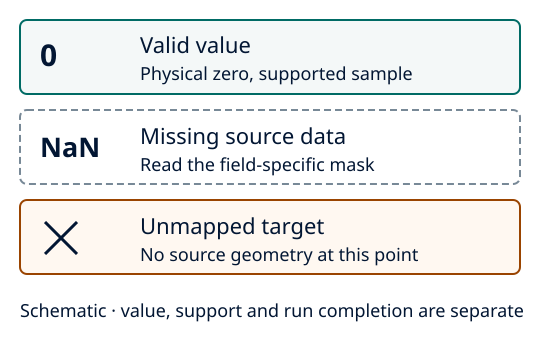

Missing values and run status
=============================

Zero is a physical value. Missing source data, unsupported geometry, rejected
interpolation and an incomplete run describe different conditions.

   Schematic. Source masks, field-local missingness and interpolation quality
   are separate from the numerical value.

The :doc:`instructional first run <../getting_started/first_run>` contains a valid
zero and a missing sample. Check both after export. Native ocean fields retain
field-specific fill-value masks; those are not inferred wet fractions. The opt-in
Meso-NH SEA interpretation has its own documented sentinel/support rules, not a
dataset-wide replacement of 999. See :doc:`../user_guide/ocean_netcdf`.

Polar outputs distinguish unmapped geometry, missing contributors, insufficient
valid-weight support and undefined centre directions. Read each field's quality
flags and coverage with its values; interpolation-weight support is not an area
fraction. Complete-ring diagnostics reject missing sectors instead of filling
them with zeros. See :doc:`../polar_projection/xESMF_proj`.

Run completion is a separate check
----------------------------------

Read ``run-status.yaml`` after a normal process exit. ``completed`` records a
finished requested execution; an accepted shortened track is ``incomplete``.
Use ``execution.require_complete_tracking: true`` to reject that prefix before
export. A missing final status or ``failed`` state is not success, even when
some products exist.

Complete earlier files can survive an interrupted run. Inspect the status
inventory, effective configuration and provenance before reusing them. Use a
fresh output directory for a retry; never remove a lock while its writer is
alive. See :doc:`../user_guide/output_files`, :doc:`../getting_started/hpc` and
:doc:`../troubleshooting`.
