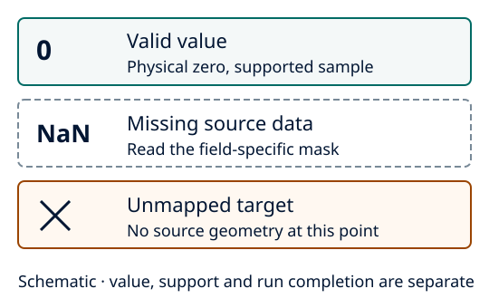

Missing values and run status
=============================

Zero is a physical value. Missing source data, unsupported geometry, rejected
interpolation and an incomplete run describe different conditions.

   Schematic. Source masks, field-local missingness and interpolation quality
   are separate from the numerical value.

The :doc:`instructional first run <../getting_started/first_run>` contains a valid
zero and a missing sample. Check both after export. Native ocean fields retain
field-specific fill-value masks; those are not inferred wet fractions. The opt-in
Meso-NH SEA interpretation has its own documented sentinel/support rules, not a
dataset-wide replacement of 999. See :doc:`../user_guide/ocean_netcdf`.

Polar outputs distinguish unmapped geometry, missing contributors, insufficient
valid-weight support and undefined centre directions. Read each field's quality
flags and coverage with its values; interpolation-weight support is not an area
fraction. Complete-ring diagnostics reject missing sectors instead of filling
them with zeros. See :doc:`../polar_projection/xESMF_proj`.

Run completion is a separate check
----------------------------------

For :doc:`../diagnostics/best_track`, check each metric's availability,
spatial support and comparability separately. A zero wind radius requires
complete support and no exceedance. A blank comparison cell can indicate
missing support, an unqualified temporal statistic or a value below export
resolution. The canonical NetCDF distinguishes these cases.

Read ``run-status.yaml`` after a normal process exit. ``completed`` records a
finished requested execution; an accepted shortened track is ``incomplete``.
Keep ``region.tracker.on_incomplete: error`` to reject that prefix before
export. A missing final status or ``failed`` state is not success, even when
some products exist.

An input-close failure marks the run failed and leaves cleanup pending. Complete
products remain in the inventory; they are not discarded to hide the failure.

Complete earlier files can survive an interrupted run. Inspect the status
inventory, captured request, effective configuration and provenance before
reusing them. Planned products are not published products; a last-recorded
``running`` state does not establish that a process is still alive. Use a
fresh output directory for a retry; never remove a lock while its writer is
alive. See :doc:`../user_guide/output_files`, :doc:`../getting_started/hpc` and
:doc:`../troubleshooting`.
