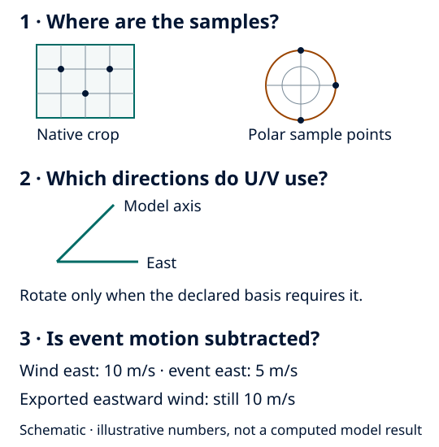

Sampling locations, vector basis and frame motion
=================================================

A moving crop changes **where** samples are selected. A vector rotation changes
the axes in which components are expressed. Subtracting the velocity of a moving
frame changes the physical velocity being reported. These operations are not
interchangeable.

   Schematic, not to scale. Polar positions follow the centre, but exported winds
   and ocean currents do not have its translation subtracted.

Native/Cartesian crops select source samples around a centre. Staggered U, V and
W can have different locations. Collocation needs actual neighbouring samples
and their coordinates; equal dimension lengths do not prove collocation.
See the C-grid and W examples in :ref:`wind-grid-contract`.

Polar output samples selected fields at geodesically located points. Launch
azimuth increases clockwise from north; local terminal bearing supplies the
radial/tangential vector directions. The bearing generally differs from launch
azimuth on a curved Earth. At the centre, radial direction is undefined.

Some trackers use motion-relative winds internally, as specified in their method
records. That does not change the frame of exported field products.

Atmospheric polar winds are prepared in an Earth-relative basis. Radial wind is
positive outward and tangential wind is positive clockwise. A finer target grid
does not improve native resolution or make point sampling conservative. Use
:doc:`../task_guides/scalars_and_vectors` to choose representations and
:doc:`../task_guides/polar_sampling` to select target geometry and coverage.
