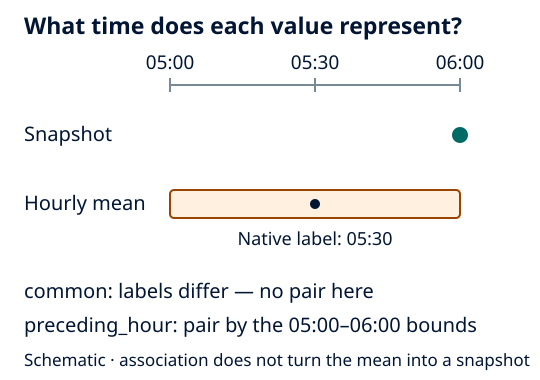

Time labels and temporal support
================================

A sample label, forecast cycle and averaging interval are different facts.
An instantaneous atmosphere field at 06:00 is not the same temporal quantity as
an ocean mean over 05:00–06:00, even if both products use a 06:00 label.

   Schematic. Association chooses records; it does not reconstruct an
   instantaneous ocean state or change source values.

Choose a coupled policy
-----------------------

* ``common`` (default) retains exact common valid labels. Excluded times are
  warned and recorded per source. No common labels is an error.
* ``strict`` requires identical source labels and prescribed-track coverage.
* ``preceding_hour`` explicitly pairs AROME instantaneous NetCDF fields at T
  with NEMO means bounded by [T-1 hour, T]. It requires unambiguous unique records,
  declared instantaneous/mean sampling and decoded one-hour bounds. It does not
  apply to CROCO. Missing partners remove the whole pairing with a recorded
  warning; malformed required metadata fails.

Under ``preceding_hour``, ocean product ``time`` is the coupling/end label;
``source_time`` keeps the native mean label and original bounds remain visible.
Use ``source_time`` when downstream analysis needs native centre labels. Read the
full :doc:`NEMO association contract <../user_guide/ocean_netcdf>` before choosing
this convention.

Prescribed trajectories use exact matching too. No policy silently shifts a
timestamp, fills a missing field, deaccumulates energy or turns a mean into a
snapshot. Check ``cell_methods``, units, bounds and forecast identity with an
ordinary reader, not the filename alone. See :doc:`../task_guides/coupled_inputs`.
