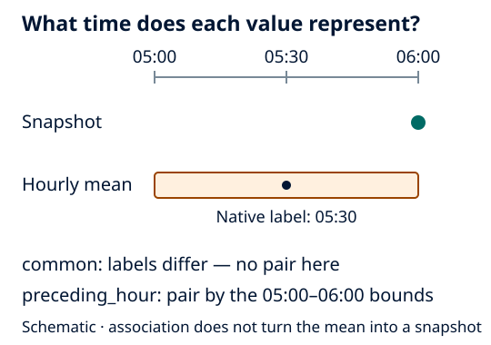

Time labels and temporal support
================================

A sample label, forecast cycle and averaging interval are different facts.
An instantaneous atmosphere field at 06:00 is not the same temporal quantity as
an ocean mean over 05:00–06:00, even if both products use a 06:00 label.

   Schematic. Association chooses records; it does not reconstruct an
   instantaneous ocean state or change source values.

.. _choose-a-coupled-policy:

Choose a centre association
---------------------------

Independent full-domain extraction keeps each source's own selected samples;
their clocks need not overlap. A crop or another operation needing centres uses
``region.sources_coupling_time_association``:

* ``exact`` (default) requires a centre at every selected source time. Source
  clocks may differ if the centre provider covers each one. Extra trajectory
  times are allowed; missing required centres fail.
* ``common`` explicitly keeps common times for the operation needing association.
  Excluded records are reported per source. No common times is an error.
* ``preceding_hour`` explicitly pairs AROME instantaneous NetCDF fields at T
  with NEMO means bounded by [T-1 hour, T]. It requires unambiguous unique records,
  declared instantaneous/mean sampling and decoded one-hour bounds. It does not
  apply to CROCO. Missing partners remove the whole pairing with a recorded
  warning; malformed required metadata fails.

For NetCDF fields, existing ``cell_methods="time: point"`` or
``GRIB_stepType="instant"`` provides evidence of instantaneous sampling.
Contradictory averaging metadata still fails; missing evidence is not inferred.

Regional crops keep the native sample label in ``time`` and the associated
centre time in ``center_time(time)``. Interval bounds keep their native meaning.
An interval-end centre is not the native mean's
sampling label or evidence that the mean is instantaneous. Read the
full :doc:`NEMO association contract <../user_guide/ocean_netcdf>` before choosing
this convention.

Association does not widen source time selection or change unrelated native
extraction. No policy silently fills a missing field, interpolates a centre,
deaccumulates energy or turns a mean into a
snapshot. Check ``cell_methods``, units, bounds and forecast identity with an
ordinary reader, not the filename alone. See :doc:`../task_guides/coupled_inputs`.
