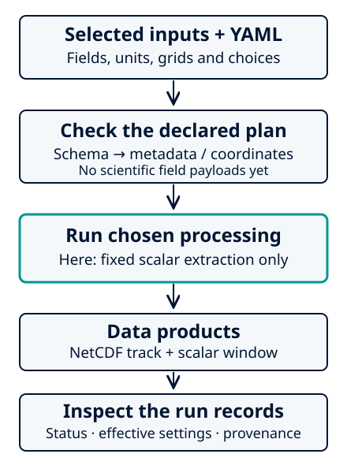

Your first run
==============

Learn how FrameIt uses a YAML file to select inputs, a region and outputs.
This example takes a small window from a generated scalar field. It needs no
model archive. First, follow :doc:`installation`.

Create the example
------------------

Use a new directory:

.. code-block:: bash

   mkdir frameit-first-run
   cd frameit-first-run
   python -m frameit.testing.documentation_example --output data/first-run.nc
   frameit init arome-fixed-scalar

You now have an input file and ``frameit.yaml``. The input has two times and a
17×17 grid around (-20°, 60°). Its scalar has units ``1``: the values have no
physical meaning. It uses the AROME NetCDF layout, but is **not an AROME producer
file or a physical simulation**.

Inspect the input:

.. code-block:: bash

   frameit inspect ./data --model arome --format netcdf --pattern first-run.nc

Check the reported field names, units, times and coordinates. For this file,
the field to extract is ``instructional_scalar``.

Read the configuration
-----------------------

This is the starter created by ``frameit init``:

.. literalinclude:: ../../../src/frameit/templates/arome-fixed-scalar.yaml
   :language: yaml

The main choices are:

* ``schema_version: "2.1"`` identifies the configuration format. Keep the quotes.
* ``model: arome`` selects the input adapter. Choose the adapter for your source,
  not the quantity you want to study.
* ``input.directory`` and ``input.pattern`` select files. Here they select
  ``data/first-run.nc``. Relative paths start at the YAML file's directory.
* ``input.format: netcdf`` declares the file format.
* ``variables.surface.names`` lists the fields to extract. Only the example
  scalar is selected here. Field names and units come from the source.
* ``tracking.method: fixed_box`` keeps one geographical centre at every time.
  The centre uses degrees north and east.
* ``domain.width_km`` sets **full widths**, not half-widths. This 4×4 km request
  selects 5×5 native points on this grid. It does not create a new grid.
* ``polar.enabled: false`` leaves polar sampling off. Installing its dependencies
  does not select it.
* ``output.overwrite: false`` protects existing products.

Name your run
-------------

Edit two values in the existing blocks of ``frameit.yaml``. Leave the other keys
unchanged; do not add a second ``run`` or ``output`` block.

.. code-block:: yaml

   run:
     name: first-run
   output:
     directory: ./results

``run.name`` supplies the product filename prefix. ``output.directory`` sets the
run directory. These choices give filenames such as
``results/products/first-run.cart.surface.nc``. They do not change the extracted values.

Check before running
---------------------

.. code-block:: bash

   frameit validate --schema-only
   frameit validate
   frameit run --dry-run

Without a filename, these commands read ``frameit.yaml``.

* ``--schema-only`` checks YAML keys, types and declared choices. It opens no data.
* ``validate`` also checks input metadata, units, coordinates and required fields.
* ``--dry-run`` shows the settings and planned products without writing them.

The last two checks can read coordinates, but not scientific field values. A
successful check does not establish scientific validity or guarantee execution.
Use the preview to check that only the intended work is selected.

   This run extracts one scalar. Data products are separate from status,
   settings and provenance. Open the figure for a full-size view.

Run and check the result
------------------------

.. code-block:: bash

   frameit run
   grep -E '^(state|tracking_complete):' results/run-status.yaml

Expect ``state: completed`` and ``tracking_complete: true``. The products are:

* ``results/products/first-run.track.nc``: the centre and native grid indices;
* ``results/products/first-run.cart.surface.nc``: the scalar window and coordinates.

Open the scalar with xarray, without importing FrameIt:

.. code-block:: bash

   python -c 'import xarray as xr; d=xr.open_dataset("results/products/first-run.cart.surface.nc", engine="netcdf4"); print(d.instructional_scalar.isel(time=0).values); print(d.instructional_scalar.attrs); d.close()'

The first time has units ``1`` and these values:

.. code-block:: text

   [[-22. -21. -20. -19. -18.]
    [-12. -11. -10.  nan  -8.]
    [ -2.  -1.   0.   1.   2.]
    [  8.   9.  10.  11.  12.]
    [ 18.  19.  20.  21.  22.]]

Zero is a valid sample. ``nan`` is missing, not zero. The second time adds 1000
to finite samples. The source values follow ``1000*t + 10*(j-8) + (i-8)``;
``j=7,i=9`` is missing. Indices start at zero. The source file is unchanged.

Keep ``results/resolved-config.yaml`` and ``results/run-provenance.yaml`` with the
products. They record the settings and processing facts. A failed run can leave
earlier complete products, so check status before using them.

Next steps
----------

Follow :doc:`../task_guides/fixed_region` to adapt the extraction to your data.
Use :doc:`quick_start` as a short CLI reminder. The
:doc:`configuration reference <../user_guide/configuration_file>` explains other
keys and defaults; :doc:`../user_guide/output_files` describes the outputs.
