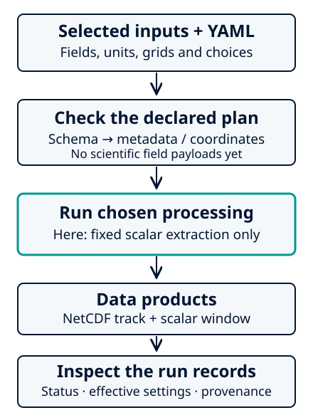

FrameIt Quick Start
====================

Extract a small fixed window, then inspect it with an ordinary NetCDF reader.
This first run needs no model archive and no optional scientific processing.
Start with the reference environment from :doc:`installation`.

Check the active installation
------------------------------

.. code-block:: bash

   frameit --help
   frameit info

``info`` identifies the active Python and available dependencies. If the console
command is unavailable, use the same environment's ``python -m frameit``.

Self-contained instructional first run
---------------------------------------

Choose a **new** directory. If this name already exists, choose another:

.. code-block:: bash

   mkdir frameit-first-run
   cd frameit-first-run
   python -m frameit.testing.documentation_example --output data/first-run.nc

The input contains a dimensionless scalar on two hour labels and a 17×17 grid
around (-20°, 60°). It is **instructional, not an AROME producer file or a physical
simulation**; it uses the structured AROME NetCDF adapter. The generator refuses
to replace an existing input.

Inspect a selected input stream
--------------------------------

.. code-block:: bash

   frameit inspect ./data --model arome --format netcdf --pattern first-run.nc

Inspection reports names, units, times and geometry. Finding a field does not
establish its scientific meaning or check every decoded value.

Select the requested processing
--------------------------------

.. code-block:: bash

   frameit init arome-fixed-scalar

No edits are needed for this example. ``frameit.yaml`` requests only
``instructional_scalar`` in a fixed window with **4 km full widths**; native
sampling rounds this example to 5×5 points at each time. Polar sampling is off,
and prior products cannot be overwritten. Relative paths use the YAML's directory.

   Schematic of this first run, not validation evidence. Checks inspect the plan;
   execution reads the selected field values. Available inputs do not select extra work.

Check schema and preview metadata
-----------------------------------

.. code-block:: bash

   frameit validate --schema-only
   frameit validate
   frameit run --dry-run

* **Schema-only:** checks keys, types and declared choices; opens no datasets.
* **Metadata preflight:** checks inventories, required inputs, units, coordinates
  and output accessibility. It can read coordinates, not scientific field payloads.
* **Dry-run:** shows effective settings, resources and planned products without
  writing products. It is not an exact memory/runtime prediction.

A successful check is not scientific approval; a selected payload can still fail
during execution. Full details are in :doc:`../user_guide/configuration_file`.

Run and review completion
---------------------------

.. code-block:: bash

   frameit run
   grep -E '^(state|tracking_complete):' output/run-status.yaml

Expect ``state: completed`` and ``tracking_complete: true``. The two data products are:

* ``output/products/arome-fixed-scalar.track.nc``: fixed centre and native indices;
* ``output/products/arome-fixed-scalar.cart.surface.nc``: scalar samples and geography.

Open the scalar independently of FrameIt. This command can be copied as written:

.. code-block:: bash

   python -c 'import xarray as xr; d=xr.open_dataset("output/products/arome-fixed-scalar.cart.surface.nc", engine="netcdf4"); print(d.instructional_scalar.isel(time=0).values); print(d.instructional_scalar.attrs); d.close()'

Expect units ``1`` and this first-time array:

.. code-block:: text

   [[-22. -21. -20. -19. -18.]
    [-12. -11. -10.  nan  -8.]
    [ -2.  -1.   0.   1.   2.]
    [  8.   9.  10.  11.  12.]
    [ 18.  19.  20.  21.  22.]]

Zero is valid; ``nan`` is missing, not zero. The second time adds 1000 to finite
samples. These arbitrary values follow ``1000*t + 10*(j-8) + (i-8)`` with zero-based
indices; ``j=7,i=9`` is missing. The source is not changed.

``output/resolved-config.yaml`` records effective choices, and
``output/run-provenance.yaml`` records processing facts. Completion belongs in
``run-status.yaml``; a failed run can retain earlier complete products. Use a new
output directory for a new attempt. See :doc:`../user_guide/output_files` for the data contract.

Help and optional batch execution
-----------------------------------

Continue with :doc:`../task_guides/fixed_region` to adapt a fixed extraction to
real inputs. The :doc:`configuration reference <../user_guide/configuration_file>`
contains defaults and precedence; :doc:`upgrading_to_v2` covers retired YAML.
:doc:`hpc` is an optional site-specific route, not a requirement for local use.
