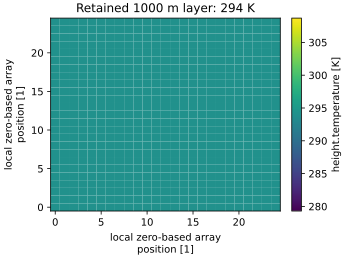

Process a small prescribed event
================================

Combine selected times and levels with independent atmosphere/ocean products
and opt-in polar sampling. Start in the directory from :doc:`generate_fixtures`.
The prescribed analytical event is instructional, not a dynamical simulation.

Select the event
----------------

Save :download:`analytic-moving.yaml <../../../example/tutorials/analytic-moving.yaml>`:

.. literalinclude:: ../../../example/tutorials/analytic-moving.yaml
   :language: yaml

Atmospheric times 1 and 2 retain the 1000 m temperature layer. Ocean times 0
and 2 retain their own three rho indices. Exact association uses supplied
centres at those actual times, without time interpolation.

Only the selected polar product calculates ``speed``. Shared polar coordinates
use the coarser prepared spacing; source clocks, masks and quantities stay separate.
No centre-motion velocity is subtracted.

Run
----

.. container:: frameit-tabs

   .. container:: frameit-tab

      .. rubric:: CLI

      .. code-block:: bash

         frameit run analytic-moving.yaml

   .. container:: frameit-tab

      .. rubric:: Python API

      .. code-block:: python

         from frameit.core.execution import execute_simulation
         from frameit.core.settings_class import SimulationConfig

         config = SimulationConfig.from_yaml_with_model_preset("analytic-moving.yaml")
         result = execute_simulation(config)
         print(result.products)

View the output
----------------

The inventory lists model-grid/polar products for each source and a track file.
Download :download:`plot_analytical_event.py <../../../example/plots/plot_analytical_event.py>`:

.. code-block:: bash

   python plot_analytical_event.py results/analytic-moving/products/analytic-moving.atmosphere.model_grid.nc analytical-event.svg

   First retained atmospheric time, 01:00. The vertical axis still has length one.

For missing-data/category practice, the generated ``missing-data`` directory
works with :download:`analytic-missing.yaml <../../../example/tutorials/analytic-missing.yaml>`.
Its strict policy preserves gaps and nearest-neighbour sampling preserves valid
category zero. Choose other policies scientifically, not to fill a figure.
See :doc:`../concepts/missingness_and_status`.

Adapt to real inputs
---------------------

Replace paths, quantities, levels and the track; verify coverage of all required
centre times. Keep diagnostics opt-in and retain the effective configuration
and provenance with the outputs.
