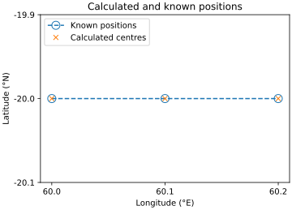

Calculate and check a cyclone track
===================================

Find a centre at each time and extract pressure around it. Start in the
directory from :doc:`generate_fixtures`. The input is a synthetic vortex with
three known positions, not a model run.

Choose the tracker
------------------

Save :download:`calculate-track.yaml <../../../example/tutorials/calculate-track.yaml>`:

.. literalinclude:: ../../../example/tutorials/calculate-track.yaml
   :language: yaml

The tracker reads mean sea-level pressure (``prmsl``, Pa) and 10 m eastward and
northward winds (``u10`` and ``v10``, m/s). The crop exports only pressure.

The first pressure search starts inside the circle given by ``initial_guess``.
At later times it searches near the previous centre. At each time it refines
the pressure minimum to a nearby wind-speed minimum. The wind search can leave
the initial circle. ``search_width_km`` and ``refine_width_km`` are full search
widths. ``region.width_km`` controls only the output crop.

Check and run
-------------

.. code-block:: bash

   frameit inspect calculate-track.yaml
   frameit validate calculate-track.yaml
   frameit config show calculate-track.yaml --effective

Check the fields, times, and requested products. These checks do not calculate
the centres.

.. container:: frameit-tabs

   .. container:: frameit-tab

      .. rubric:: CLI

      .. code-block:: bash

         frameit run calculate-track.yaml

   .. container:: frameit-tab

      .. rubric:: Python API

      .. code-block:: python

         from frameit.core.execution import execute_simulation
         from frameit.core.settings_class import SimulationConfig

         config = SimulationConfig.from_yaml_with_model_preset("calculate-track.yaml")
         result = execute_simulation(config)
         print(result.products)

Check the track
---------------

Check ``results/calculate-track/run-status.yaml`` for ``state: completed``.
It lists the track and pressure crop. The track has points at 00:00, 01:00 and
02:00 on 1 January 2000. Check for latitude −20° and longitudes 60°, 60.1° and
60.2°. The native grid indices are ``cy = [12, 12, 12]`` and
``cx = [12, 14, 16]``. These are the rows and columns of the same points.
The tracker does not find positions between grid points. Pressure at the
centre cell of the crop is 96000 Pa at all three times.

Copy this into ``plot_calculate_track.py``:

.. literalinclude:: ../../../example/plots/plot_calculate_track.py
   :language: python

Optional: :download:`script file <../../../example/plots/plot_calculate_track.py>`.

.. code-block:: bash

   python plot_calculate_track.py \
     results/calculate-track/products/calculate-track.track.nc \
     data/track.nc calculate-track.svg

   The crosses are the calculated centres. The circles are the known
   positions. FrameIt did not read the known track to calculate the centres.

Try a seed outside the grid
---------------------------

Copy the request to ``bad-seed.yaml``. In the copy, set the longitude under
``region.tracker.initial_guess`` to ``50`` and ``output.directory`` to
``./results/bad-seed``. Run ``frameit run bad-seed.yaml``. There is no finite
pressure inside that search circle, so the tracker stops without a track.

Adapt to your data
------------------

Use the source metadata to check the field names, units, and wind directions.
Place the seed near the intended disturbance. Check the first centre and any
large jumps against the source fields. A local search with no valid data can
fall back to searching the full domain, which may find a different disturbance.
See :doc:`../tracker/pressure_wind_tracker` for the search rules. The
:doc:`../tracker/pressure_centroid` method needs other fields and wider valid
coverage; it is not used here.
