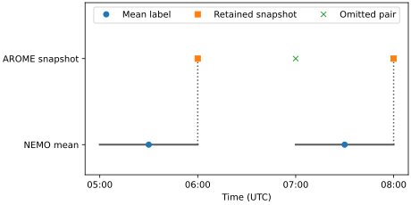

Pair atmosphere and ocean samples on different clocks
=====================================================

Use a moving crop to compare AROME snapshots with NEMO hourly means. Start
in the directory from :doc:`generate_fixtures`. The inputs are synthetic.

Read the times and bounds
-------------------------

In ``coupled-clocks/``, the atmosphere and track have times on the hour.
The NEMO file labels each mean at the middle of its interval. All times
below are on 1 January 2000.

.. list-table::
   :header-rows: 1

   * - AROME snapshot and track centre
     - NEMO label
     - NEMO averaging interval
   * - 06:00
     - 05:30
     - 05:00–06:00
   * - 07:00
     - No sample
     - No 06:00–07:00 interval
   * - 08:00
     - 07:30
     - 07:00–08:00

Save :download:`coupled-clocks.yaml <../../../example/tutorials/coupled-clocks.yaml>`:

.. literalinclude:: ../../../example/tutorials/coupled-clocks.yaml
   :language: yaml

To see why the default fails, copy the request to ``exact-clocks.yaml``.
Remove its ``sources_coupling_time_association`` line and run
``frameit validate exact-clocks.yaml``. The default ``exact`` needs a track
centre at each selected time. The track has no centre at 05:30 or 07:30.
See :ref:`E1404 <e1404>`.

Choose the preceding hour
-------------------------

Use the original request. ``preceding_hour`` pairs a snapshot at time T
with the NEMO mean whose one-hour interval ends at T. It needs AROME NetCDF
fields marked as instantaneous and NEMO NetCDF fields with declared means
and one-hour bounds. It does not match by the nearest label.

There is no mean ending at 07:00. FrameIt warns and skips the whole 07:00
pair, including the atmospheric snapshot. It does not fill the gap.

.. code-block:: bash

   frameit inspect coupled-clocks.yaml
   frameit validate coupled-clocks.yaml

.. container:: frameit-tabs

   .. container:: frameit-tab

      .. rubric:: CLI

      .. code-block:: bash

         frameit run coupled-clocks.yaml

   .. container:: frameit-tab

      .. rubric:: Python API

      .. code-block:: python

         from frameit.core.execution import execute_simulation
         from frameit.core.settings_class import SimulationConfig

         config = SimulationConfig.from_yaml_with_model_preset("coupled-clocks.yaml")
         result = execute_simulation(config)
         print(result.products)

Check the two products
----------------------

Open the two files listed in ``results/coupled-clocks/run-status.yaml``.

* In the AROME file, ``time`` contains 06:00 and 08:00.
* In the NEMO file, ``time`` contains 05:30 and 07:30. Its bounds still
  describe the original means. ``center_time`` contains 06:00 and 08:00,
  the times of the centres used for the crops.

Check ``time_alignment.omitted_pairings`` in the status or provenance file.
The omitted time is 07:00 and the missing source is ``ocean``.

Copy this into ``plot_coupled_clocks.py``:

.. literalinclude:: ../../../example/plots/plot_coupled_clocks.py
   :language: python

Optional: :download:`script file <../../../example/plots/plot_coupled_clocks.py>`.

.. code-block:: bash

   python plot_coupled_clocks.py \
     results/coupled-clocks/products/coupled-clocks.atmosphere.model_grid.nc \
     results/coupled-clocks/products/coupled-clocks.ocean.model_grid.nc \
     results/coupled-clocks/run-status.yaml coupled-clocks.svg

   Each bar spans a NEMO interval. The dotted line links its end to the
   snapshot. The ocean values remain hourly means, not snapshots.

Adapt to your data
------------------

Check the sampling metadata and bounds before choosing this rule. It is not
for CROCO, FA, or AROME GRIB. ``common`` keeps matching labels; it does not match
by bounds. Independent full-domain extraction can keep each source's own times.
See :doc:`../concepts/time_support` for the rules.
