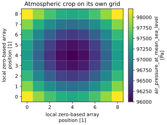

Process coupled sources
=======================

Extract atmosphere and ocean fields without forcing them onto one grid or
clock. Start in the directory from :doc:`generate_fixtures`.

Select independent sources
--------------------------

Save :download:`coupled-inputs.yaml <../../../example/tutorials/coupled-inputs.yaml>`:

.. literalinclude:: ../../../example/tutorials/coupled-inputs.yaml
   :language: yaml

Both sources have 00:00, 01:00 and 02:00 samples, on separate grids. The atmosphere
contains temperature and Earth-relative winds at 10 m; the ocean contains a
prescribed surface cold trail. These are analytical signals, not a coupled simulation.
The existing height label is selected with ``values`` and ``units``; the ocean
request selects its own surface rho index.

.. _choose-the-reference-and-time-policy:

A fixed centre covers each source's actual times. A supplied or calculated
track instead needs centres at every required time under the default exact
association. See :doc:`moving_region` and :doc:`../concepts/time_support`.
To pair AROME snapshots with NEMO hourly means, see :doc:`coupled_clocks`.

Run
----

.. container:: frameit-tabs

   .. container:: frameit-tab

      .. rubric:: CLI

      .. code-block:: bash

         frameit run coupled-inputs.yaml

   .. container:: frameit-tab

      .. rubric:: Python API

      .. code-block:: python

         from frameit.core.execution import execute_simulation
         from frameit.core.settings_class import SimulationConfig

         config = SimulationConfig.from_yaml_with_model_preset("coupled-inputs.yaml")
         result = execute_simulation(config)
         print(result.products)

View the output
----------------

The inventory lists separate atmosphere and ocean NetCDF files. Copy this into
``plot_coupled_inputs.py``:

.. literalinclude:: ../../../example/plots/plot_coupled_inputs.py
   :language: python

Optional: :download:`script file <../../../example/plots/plot_coupled_inputs.py>`.

.. code-block:: bash

   python plot_coupled_inputs.py \
     results/coupled-inputs/products/coupled-inputs.atmosphere.model_grid.nc \
     results/coupled-inputs/products/coupled-inputs.ocean.model_grid.nc coupled-inputs.svg

   Columns show the three input times. Top: 10 m air temperature (K) with wind
   vectors (m s-1). Bottom: SST (K). Every panel uses the same fixed geographical
   bounds, with one colour scale per row. Winds remain Earth-relative.

The plot uses the central latitude for map aspect ratio. See
:doc:`../reference/analytical_inputs` for the prescribed warm/cold signals and
:doc:`../user_guide/ocean_netcdf` for real ocean grids, masks and depth conventions.

Adapt to real inputs
---------------------

Replace both adapters, paths, quantities and vertical selections. Inspect each
stream independently and declare the required time association explicitly.
