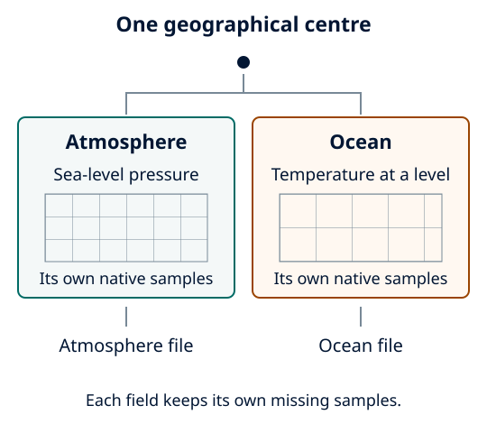

Process coupled sources
=======================

Use named sources when inputs have different grids, quantities or layouts.
They share a geographical request, not an assumed common physical representation.
Inspect each stream independently. This complete example uses illustrative paths
for atmospheric pressure and native NEMO potential temperature:

.. code-block:: yaml

   schema_version: 3
   run:
     name: coupled
   sources:
     atmosphere:
       model: arome
       files: ./data/atmosphere.nc
       variables:
         2d: [prmsl]
     ocean:
       model: nemo
       files: ./data/ocean.nc
       variables:
         3d: [votemper]
         levels: {indices: [0]}
   region:
     center: {latitude: -20, longitude: 60}
     width_km: {x: 20, y: 20}
   output:
     directory: ./results/coupled

Replace paths, field names, native levels and geometry from the selected inputs.
Source names do not establish model or physical type. Only one source of each
physical type is allowed. Native grids, units, masks and sampling remain distinct.

.. _choose-the-reference-and-time-policy:

Choose centres and time association
-----------------------------------

A fixed ``region.center`` needs no reference source. A supplied
``region.track.file`` must cover every required source time by default.
Calculated tracking uses the atmospheric source, whatever its name; there is no
tracker-source selector. See :doc:`moving_region` for the three mutually
exclusive centre providers.

Tracker inputs are internal dependencies, not extra exports. Confirm their units,
sampling and wind basis from producer evidence. For
:doc:`../tracker/pressure_centroid`, retain the full 500-km reference-ring coverage,
vertical brackets around 2,000 m (geopotential height for AROME, altitude ASL for
Meso-NH), and at least two selected atmospheric samples.
The extraction box does not limit tracker input coverage.

``region.sources_coupling_time_association: exact`` is the default. Each selected
source sample needs a centre, but source timelines may differ. A fixed centre
covers each source's own samples; a calculated atmospheric track may not cover
different ocean times. Missing required centres fail.

Explicit ``common`` reports the records excluded for the operation needing
association. It does not widen source selection or alter unrelated full-domain
extraction. The AROME/NEMO-only ``preceding_hour`` method has additional
instantaneous/mean and interval requirements; see :doc:`../concepts/time_support`.

   Schematic. Both inputs follow the same geographical centre, but select their
   own native samples and retain their own missing values and output files.

Keep source meaning visible
---------------------------

Keep NEMO T/U/V/W contexts distinct even when dimensions have the same names.
Use separate runs when a requested combination has no admitted shared output
contract. CROCO sigma indices are not physical depths. Native currents/stresses
are not atmospheric winds; NEMO analysed components are unsupported. CROCO
rho/Earth currents require the documented static masks, angles and brackets.
See :doc:`../user_guide/ocean_netcdf` for these contracts, and
:doc:`../user_guide/fa_inputs` for explicit native FA declarations.

Request ``products.polar.shared_grid: true`` only when common point coordinates
are needed. The product's exact field filter determines participating sources;
its centre provider need not export fields. The default shared radial step uses
the coarsest participating spacing. Native clocks, vertical axes, scalar/vector
eligibility, masks and interpolation support remain source-specific.
The radius and required support do not depend on the model-grid crop.
Use :doc:`polar_sampling` for a complete single-source request and
:doc:`../user_guide/fa_surface` for the shared-target contract.

Check and run
-------------

Check time exclusions and source-specific native indices in status/provenance.
A centre outside a required source footprint fails. Read source-qualified
products separately and compare coordinates, time bounds, units and missing
support before combining them. Equal array shapes or target IDs do not establish
physical equivalence; see :doc:`../user_guide/output_files`.

Save the first complete request as ``coupled.yaml`` after adapting both input
paths, quantities and native level selection:

.. code-block:: bash

   python -m frameit inspect coupled.yaml
   python -m frameit validate coupled.yaml
   python -m frameit run coupled.yaml
   python -m frameit status results/coupled

Expect two field products under ``results/coupled/products``:
``coupled.atmosphere.model_grid.nc`` and ``coupled.ocean.model_grid.nc``.
No separate trajectory or polar file is selected by this example.

.. code-block:: python

   import xarray as xr

   with xr.open_dataset("results/coupled/products/coupled.atmosphere.model_grid.nc") as air:
       print(air.prmsl.dims, air.prmsl.attrs["units"], air.time.values)
   with xr.open_dataset("results/coupled/products/coupled.ocean.model_grid.nc") as ocean:
       print(ocean.votemper.dims, ocean.votemper.attrs["units"], ocean.time.values)

Compare each product with its own source; different clocks are not an error
unless a selected operation requires an association. Missing required centre
times or unresolved physical types must be repaired explicitly. Use a fresh
output directory for a retry. For a runnable generated-input case, follow
:doc:`analytical_event`.
