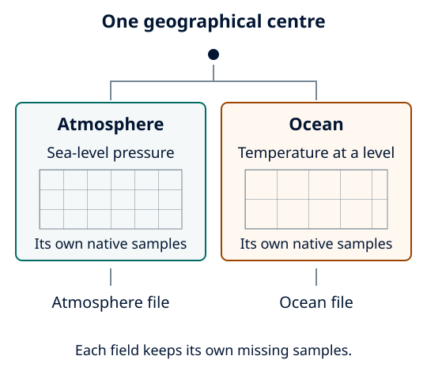

Process coupled sources
=======================

Use named sources when inputs have different grids, quantities or layouts.
They share geographical centres, not an assumed common physical representation.
Inspect each stream independently, then generate one matching starter:

.. code-block:: bash

   frameit init arome-nemo
   # Or, in a separate run directory:
   frameit init mesonh-croco

AROME+NEMO selects independent pressure and native potential-temperature samples.
Meso-NH+CROCO selects explicitly interpreted SEA SST/SSS and native temp/salt.
The latter requires supported Meso-NH SEA metadata and ``FRAC_SEA`` support, plus
CROCO history/Vtransform=2 metadata. Neither starter selects currents or polar
sampling. Adapt paths, source fields, native levels, centre and full box widths.

Choose the reference and time policy
------------------------------------

``tracking.source`` identifies the source supplying continuous centres. Top-level
``model`` must match it. Each source has its own ``model``, ``input`` and
``variables``; do not put a shared variable selection at the top level.
Both pairings support ``fixed_box`` (default), ``prescribed_track``,
``pressure_wind`` and ``pressure_centroid``. Use a model selector when choosing
tracking; named starters such as ``arome-nemo`` reject composition flags.
For a supplied trajectory:

.. code-block:: bash

   frameit init arome --coupling nemo --tracking prescribed_track

Supply an appropriate track. To calculate centres from atmospheric fields instead,
use one of these commands in a fresh run directory:

.. code-block:: bash

   frameit init arome --coupling nemo --tracking pressure_centroid
   # Or for Meso-NH+CROCO:
   frameit init mesonh --coupling croco --tracking pressure_centroid

Use ``--tracking pressure_wind`` instead for :doc:`../tracker/pressure_wind_tracker`.
The atmospheric source supplies the tracker fields and wind declarations; ocean
fields and sampling remain independent. Confirm the declared source wind basis
against producer metadata. For :doc:`../tracker/pressure_centroid`, retain the
full 500-km reference-ring coverage and vertical brackets around 2,000 m
(geopotential height for AROME, altitude ASL for Meso-NH), plus at least two exact
common times. The extraction box does not limit the tracker input coverage.

Use ``input.time_alignment: common`` for exact
common labels (default), or ``strict`` to require equal source times and full
track coverage. Neither interpolates time. The explicit AROME/NEMO-only
``preceding_hour`` policy has additional temporal metadata requirements; see
:doc:`../concepts/time_support` before selecting it.

   Schematic. Both inputs follow the same geographical centre, but select their
   own native samples and retain their own missing values and output files.

Keep source meaning visible
---------------------------

NEMO T/U/V/W contexts can require separate sources even when dimensions have the
same names. CROCO sigma indices are not physical depths. Native currents/stresses
are not atmospheric winds; NEMO analysed components are unsupported. CROCO
rho/Earth currents require the documented static masks, angles and brackets.
See :doc:`../user_guide/ocean_netcdf` for these contracts, and
:doc:`../user_guide/fa_inputs` for explicit native FA declarations.

Enable ``polar.shared_target: true`` only when common point coordinates are
needed. Participating sources must agree on target geometry; the default shared
radial step is the coarsest participating spacing. Scalar/vector eligibility,
masks and interpolation support stay source-specific. The detailed target
contract remains in :doc:`../user_guide/fa_surface`.

Check and run
-------------

.. code-block:: bash

   frameit validate --schema-only
   frameit validate
   frameit run --dry-run
   frameit run

Check time exclusions and source-specific native indices in status/provenance.
A centre outside a required source footprint fails. Read source-qualified
products separately and compare coordinates, time bounds, units and missing
support before combining them. Equal array shapes or target IDs do not establish
physical equivalence; see :doc:`../user_guide/output_files`.
