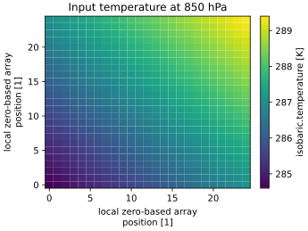

Select fields and vertical levels
=================================

Select existing input levels, independently on pressure and height axes.
Start in the directory from :doc:`generate_fixtures`.

Select fields
--------------

Save :download:`field-selection.yaml <../../../example/tutorials/field-selection.yaml>`:

.. literalinclude:: ../../../example/tutorials/field-selection.yaml
   :language: yaml

A 2D field has no selectable vertical axis. Put fields with a vertical axis
under ``3d``. The pressure request selects existing 850 and 700 hPa labels, in
that order; the input coordinates are in Pa. This is selection, not interpolation.

.. _choose-one-level-strategy-per-group:

Choose a level strategy
-----------------------

* **All input levels:** omit ``levels``, including any input boundary levels.
* **Physical domain:** ``levels: {domain: physical}`` excludes model boundary
  or halo levels outside the producer-declared physical range. It does not
  select “positive heights”. Without evidence of that range, the request fails.
* **Input positions:** ``levels: {indices: [5, 0]}`` keeps original positions
  5 then 0, counting from zero.
* **Existing labels:** ``levels: {values: [850, 700], units: hPa}``.
  An interval such as ``{values: {min: 700, max: 850}, units: hPa}`` keeps
  available labels inside those bounds.

With a flat ``3d`` list, put the shared selector in ``variables.levels``.

.. _explicit-vertical-groups:

Select groups independently
---------------------------

Use the group identifiers reported by inspection; pressure groups are
``isobaric``, with units supplied separately. Each group's ``names`` and
``levels`` select its own fields and axis. Omit local ``levels`` to keep that
group's complete input axis.

Use qualified names such as ``isobaric.temperature`` in product filters and
other field references. The exported variable has that same name:
``ds["isobaric.temperature"]``.

See :doc:`../reference/vertical_levels` for units, matching roundoff,
selection grids and derived-field restrictions.

Run
----

.. container:: frameit-tabs

   .. container:: frameit-tab

      .. rubric:: CLI

      .. code-block:: bash

         frameit run field-selection.yaml

   .. container:: frameit-tab

      .. rubric:: Python API

      .. code-block:: python

         from frameit.core.execution import execute_simulation
         from frameit.core.settings_class import SimulationConfig

         config = SimulationConfig.from_yaml_with_model_preset("field-selection.yaml")
         result = execute_simulation(config)
         print(result.products)

View the output
----------------

Copy this into ``plot_field_selection.py``:

.. literalinclude:: ../../../example/plots/plot_field_selection.py
   :language: python

Optional: :download:`script file <../../../example/plots/plot_field_selection.py>`.

.. code-block:: bash

   python plot_field_selection.py results/field-selection/products/field-selection.atmosphere.model_grid.nc field-selection.svg

   First time at 850 hPa. The output also retains 700 hPa and the two selected
   height positions; the pressure coordinate uses hPa.

Adapt to real inputs
---------------------

Replace the file, field/group names and selectors using the input metadata.
Confirm coordinate units and which boundary levels, if any, are nonphysical.
