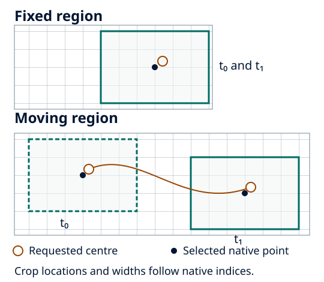

Extract a fixed geographical region
====================================

Use a fixed region when the scientific comparison concerns the same place at
each time, rather than a window following an event. FrameIt maps the declared
latitude/longitude to a native grid point and extracts neighbouring samples.
The Cartesian crop is grid-aligned, not recentered by interpolation.

Prerequisites and starter
--------------------------

Use the :doc:`reference environment <../getting_started/installation>` and an
inspected input stream with known fields, coordinate units and valid times.
The example below reuses the :doc:`instructional scalar
<../getting_started/first_run>`.
Start in a new directory:

.. code-block:: bash

   mkdir frameit-fixed-region
   cd frameit-fixed-region
   python -m frameit.testing.documentation_example --output data/first-run.nc

Save this complete request as ``frameit.yaml``:

.. code-block:: yaml

   schema_version: 3
   run:
     name: fixed-region
   sources:
     atmosphere:
       model: arome
       files: ./data/first-run.nc
       variables:
         2d: [instructional_scalar]
   region:
     center: {latitude: -20, longitude: 60}
     width_km: {x: 4, y: 4}
   output:
     directory: ./output
   resources:
     synchronous_export: true
     scheduler: synchronous

Omitted ``products`` requests model-grid output only. The centre does not request
a trajectory file or diagnostics. Omitting ``region`` instead keeps the full
domain without a centre.

   Schematic, not to scale. The crop snaps to native indices. Requested full
   widths are rounded to native point counts; realised extents can differ.
   The requested continuous centre remains distinct from the selected native point.

Adapt it to real inputs
------------------------

For this instructional run, leave the example values unchanged. For real work,
edit ``frameit.yaml`` only after inspecting the intended stream:

* Replace ``sources.atmosphere.files`` and ``sources.atmosphere.variables.2d``
  together. ``instructional_scalar`` is not a producer field. Declare each needed
  vertical selection explicitly; stored indices are not physical depths.
* Set ``region.center`` in degrees north/east. Use a location relevant
  to the question, not a supplied illustrative centre.
* Set both ``region.width_km`` components as positive **full widths in km**.
   Rounding to native grid points changes the realised extent. Near an edge the
   crop keeps its shape with missing outside samples. A centre outside a required
   source footprint fails rather than snapping to an edge point.
* Keep a fresh ``output.directory`` and ``overwrite: false``. Leave polar sampling
  off unless selected for a separate purpose. Native wind/current copies need no
  pair declaration. Analysis operations require the documented sampling and basis
  evidence.

See :doc:`../user_guide/configuration_file` for the full schema/defaults,
:doc:`../user_guide/input_files` for stream layouts, and
:doc:`../user_guide/ocean_netcdf` for native NEMO/CROCO distinctions.

Check, run and interpret
-------------------------

Execute the YAML through the Python API:

.. code-block:: python

   from frameit.core.execution import execute_simulation
   from frameit.core.settings_class import SimulationConfig

   config = SimulationConfig.from_yaml_with_model_preset("frameit.yaml")
   result = execute_simulation(config)
   print(result.products)

Metadata checks may read coordinates, but scientific values are read during
execution. Reopen the listed scalar product without importing FrameIt:

.. code-block:: python

   import numpy as np
   import xarray as xr

   with xr.open_dataset("output/products/fixed-region.atmosphere.model_grid.nc") as out:
       with xr.open_dataset("data/first-run.nc") as source:
           expected = source.instructional_scalar.isel(
               latitude=slice(6, 11), longitude=slice(6, 11))
           np.testing.assert_array_equal(out.instructional_scalar.values, expected.values)
       print(out.sizes, out.instructional_scalar.attrs)

The two samples retain their native 5×5 scalar values. The central zero stays
valid and the missing sample stays NaN. No track, polar file, wind diagnostic or
unselected field is requested.

Use the actual status inventory for other run names or backends. Reopen products
with your normal reader, check coordinates/units and distinguish missing support
from physical zero. Keep the effective configuration and provenance alongside
the data. See
:doc:`../tracker/fixed_box` and :doc:`../user_guide/output_files`.
