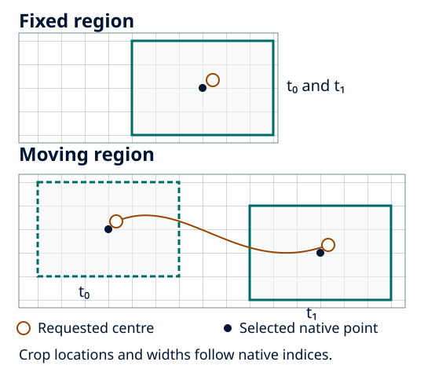

Extract a fixed geographical region
====================================

Use a fixed region when the scientific comparison concerns the same place at
each time, rather than a window following an event. FrameIt selects native grid
samples around a declared latitude/longitude. This does not itself interpolate
fields, rotate vectors or subtract event motion.

Prerequisites and starter
--------------------------

Use the :doc:`reference environment <../getting_started/installation>` and an
inspected input stream with known fields, coordinate units and valid times.
The executable pilot below reuses the :doc:`instructional scalar
<../getting_started/first_run>`; it does not qualify a real AROME producer.
Start in a new directory:

.. code-block:: bash

   mkdir frameit-fixed-region
   cd frameit-fixed-region
   python -m frameit.testing.documentation_example --output data/first-run.nc
   frameit init arome --tracking fixed_box

This is equivalent to ``frameit init arome-fixed-scalar``. The generator preserves
the resource comments. Its geographical choices are:

.. literalinclude:: ../../../src/frameit/templates/arome-fixed-scalar.yaml
   :language: yaml
   :start-at: tracking:
   :end-at: width_km: {x: 4, y: 4}

   Schematic, not to scale. The centre defines the requested location; the native
   grid determines selected samples. Full box widths are distinct from tracker
   search half-widths and from any vector-basis or reference-frame change.

Adapt it to real inputs
------------------------

For this instructional run, leave the generated values unchanged. For real work,
edit ``frameit.yaml`` only after inspecting the intended stream:

* Replace ``input.directory/pattern/format`` and ``variables.surface.names``
  together. ``instructional_scalar`` is not a producer field. Declare each needed
  vertical selection explicitly; stored indices are not physical depths.
* Set ``tracking.fixed_box.center`` in degrees north/east. Use a location relevant
  to the question, not a supplied illustrative centre.
* Set both ``domain.width_km`` components as positive **full widths in km**.
  Rounding to native grid points changes the realised extent. Near an edge the
  supported ``pad_nan`` policy retains centred geometry and missing outside samples;
  it does not invent source data.
* Keep a fresh ``output.directory`` and ``overwrite: false``. Leave polar sampling
  off unless selected for a separate purpose. Adding winds or currents requires
  their own sampling/basis declarations, not just extra field names.

See :doc:`../user_guide/configuration_file` for the full schema/defaults,
:doc:`../user_guide/input_files` for stream layouts, and
:doc:`../user_guide/ocean_netcdf` for native NEMO/CROCO distinctions.

Check, run and interpret
-------------------------

.. code-block:: bash

   frameit validate --schema-only
   frameit validate
   frameit run --dry-run
   frameit run
   grep -E '^(state|tracking_complete):' output/run-status.yaml
   python -c 'import xarray as xr; d=xr.open_dataset("output/products/arome-fixed-scalar.cart.surface.nc", engine="netcdf4"); print(d.sizes); print(d.instructional_scalar.isel(time=0).values); d.close()'

Schema checks open no data; metadata checks can read coordinates but not field
payloads. Execution reads the selected values. For this input expect a complete
two-time track and a ``time=2, y_box=5, x_box=5`` scalar product, with the same
5×5 values shown in the first run. The central zero stays valid and the missing
sample stays NaN. No polar file, wind diagnostic or unselected field is produced.

Use the actual status inventory for other run names or backends. Reopen products
with your normal reader, check coordinates/units and distinguish missing support
from physical zero. The source input stays unchanged. Keep the effective
configuration and provenance alongside the data; a completed run is not a
scientific-validity certificate. Details remain in
:doc:`../tracker/fixed_box` and :doc:`../user_guide/output_files`.
