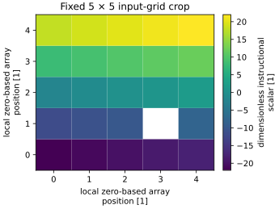

Extract a fixed geographical region
====================================

Extract the same place at every input time, without interpolating a new grid.
Start in the directory from :doc:`generate_fixtures`.

Select the region
-----------------

Save :download:`fixed-region.yaml <../../../example/tutorials/fixed-region.yaml>`:

.. literalinclude:: ../../../example/tutorials/fixed-region.yaml
   :language: yaml

The centre selects a native grid point. Full widths of 4 km produce a 5×5
crop here; rounding means realised extents can differ from requested widths.
Omit ``region`` to retain the full input domain.

Run
----

.. container:: frameit-tabs

   .. container:: frameit-tab

      .. rubric:: CLI

      .. code-block:: bash

         frameit run fixed-region.yaml

   .. container:: frameit-tab

      .. rubric:: Python API

      .. code-block:: python

         from frameit.core.execution import execute_simulation
         from frameit.core.settings_class import SimulationConfig

         config = SimulationConfig.from_yaml_with_model_preset("fixed-region.yaml")
         result = execute_simulation(config)
         print(result.products)

View the output
----------------

Download :download:`plot_fixed_region.py <../../../example/plots/plot_fixed_region.py>`:

.. code-block:: bash

   python plot_fixed_region.py results/fixed-region/products/fixed-region.atmosphere.model_grid.nc fixed-region.svg

   First output time. Zero stays valid and the missing sample stays missing.

The NetCDF retains both input times. No track or polar product is requested.
See :doc:`../tracker/fixed_box` for edge handling.

Adapt to real inputs
---------------------

Replace the input path, model and field names. Set the geographical centre and
both full widths in km; keep a fresh output directory.
