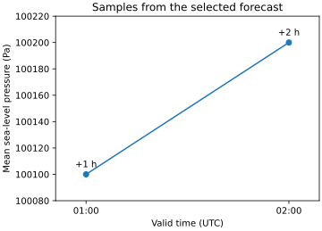

Build a request from a forecast archive
=======================================

Pick one forecast start and keep two samples. Start in the directory from
:doc:`generate_fixtures`. The three small AROME-layout files are synthetic.

Identify the forecast
---------------------

A forecast's start is its **cycle**. Its **lead** is the time since that
start. A sample's **valid time** is the time it describes.

In these files, ``time`` is the forecast start, ``step`` is the lead, and
``valid_time`` is the sample time. Copy this into ``inspect_forecast_archive.py``
and run ``python inspect_forecast_archive.py`` to read them before choosing a
cycle.

.. literalinclude:: ../../../example/tutorials/inspect_forecast_archive.py
   :language: python

Optional: :download:`script file <../../../example/tutorials/inspect_forecast_archive.py>`.

On 1 January 2000, ``z-earlier.nc`` and ``a-later.nc`` start at 00:00.
``b-other-cycle.nc`` starts at 01:00. Both cycles describe 02:00. They are
not the same forecast. Use the decoded times, not the names of the files.

Save :download:`forecast-archive.yaml <../../../example/tutorials/forecast-archive.yaml>`:

.. literalinclude:: ../../../example/tutorials/forecast-archive.yaml
   :language: yaml

To see the error, copy the request to ``no-cycle.yaml`` and remove its
``cycle`` line. Run ``frameit validate no-cycle.yaml``. It reports
:ref:`E1403 <e1403>` because the files contain more than one cycle.

Check and run
-------------

Use the original request. Its ``cycle`` selects the forecast started at
00:00. The valid-time window keeps 01:00 and 02:00, including both endpoints.

.. code-block:: bash

   frameit inspect forecast-archive.yaml
   frameit validate forecast-archive.yaml
   frameit config show forecast-archive.yaml --effective

Inspect ``prmsl`` (mean sea-level pressure, Pa) and the selected dates and
files. The request copies that field on its original grid.

.. container:: frameit-tabs

   .. container:: frameit-tab

      .. rubric:: CLI

      .. code-block:: bash

         frameit run forecast-archive.yaml

   .. container:: frameit-tab

      .. rubric:: Python API

      .. code-block:: python

         from frameit.core.execution import execute_simulation
         from frameit.core.settings_class import SimulationConfig

         config = SimulationConfig.from_yaml_with_model_preset("forecast-archive.yaml")
         result = execute_simulation(config)
         print(result.products)

Check the output
----------------

Use the product listed in ``results/forecast-archive/run-status.yaml``.
The output has valid times 01:00 and 02:00, in that order. Its
``forecast_reference_time`` is 00:00 and ``step`` holds the 1 h and 2 h leads.
Pressure is 100100 Pa at 01:00 and 100200 Pa at 02:00. The 101200 Pa sample
from the other cycle is not present.

In ``results/forecast-archive/run-provenance.yaml``, check
``binding.atmosphere.files``. It lists ``z-earlier.nc`` and ``a-later.nc``,
not ``b-other-cycle.nc``.

Copy this into ``plot_forecast_archive.py``:

.. literalinclude:: ../../../example/plots/plot_forecast_archive.py
   :language: python

Optional: :download:`script file <../../../example/plots/plot_forecast_archive.py>`.

.. code-block:: bash

   python plot_forecast_archive.py \
     results/forecast-archive/products/forecast-archive.atmosphere.model_grid.nc forecast-archive.svg

   Pressure at the first grid point. The labels show the lead from 00:00.

Adapt to your data
------------------

Inspect your files before choosing fields, a cycle, or a time window.
Use ``files`` and ``exclude`` to limit which files can supply records. If
two files supply the same field, level, time, and cycle, FrameIt does not
choose one for you. See :doc:`../user_guide/input_files`.
