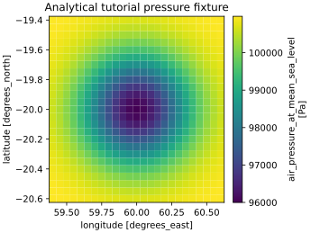

Generate the tutorial fixtures
==============================

Start here once, then choose any task. You need the
:doc:`reference environment <../getting_started/installation>`, but **no
existing GRIB, NetCDF or simulation data**.

These fixtures are only for the task tutorials. Their analytical formulas
are not a simulation, a balanced atmosphere/ocean state, or model validation.

Generate all inputs
--------------------

Choose a new directory; existing directories are refused.

.. container:: frameit-tabs

   .. container:: frameit-tab

      .. rubric:: CLI

      .. code-block:: bash

         frameit generate-tests-fixtures --output tutorial-data

   .. container:: frameit-tab

      .. rubric:: Python API

      .. code-block:: python

         from pathlib import Path
         from frameit.testing.documentation_example import create_task_fixtures

         paths = create_task_fixtures(Path("tutorial-data"))
         print(paths)

The command creates twelve small NetCDF files:

* ``first-run.nc``: dimensionless scalar, with a valid zero and a missing sample;
* ``stationary/``: analytical atmosphere, ocean and stationary track;
* ``data/``: the same formulas with a translating prescribed centre;
* ``missing-data/``: explicit missing samples and categorical labels;
* ``pressure.nc``: temperatures on pressure and height axes;
* ``interfaces.nc``: native interface W and mass-level coordinates.

Work inside ``tutorial-data`` for the remaining tasks. Save each downloaded
YAML and plotting script there. Every task uses a separate results directory.
See :doc:`../reference/analytical_inputs` for formulas, units and masks.

View a generated dataset
------------------------

Download :download:`plot_generate_fixtures.py <../../../example/plots/plot_generate_fixtures.py>`.
It reads the generator's output with ordinary xarray:

.. code-block:: bash

   cd tutorial-data
   python plot_generate_fixtures.py stationary/atmosphere.nc fixtures.svg

   Output of the fixture generator, before any extraction.

Adapt to real inputs
---------------------

Do not use these fixtures for scientific conclusions. For real processing,
replace the paths and adapter declarations using :doc:`../reference/inputs`;
the next tasks identify their task-specific changes.
