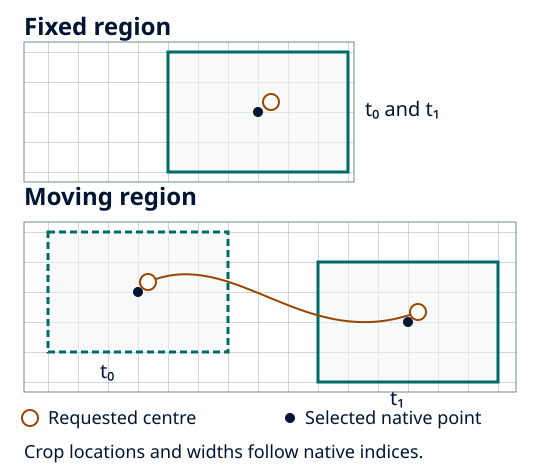

Follow a moving region
======================

Choose how the geographical centre is supplied before choosing fields. A
prescribed trajectory works for all four model selectors. Automatic atmospheric
tracking requires the chosen method's physical inputs.

Use a supplied track
--------------------

.. code-block:: bash

   frameit init arome --tracking prescribed_track

Adapt the generated input selection, domain and output directory. Supply a
NetCDF trajectory with decoded time, latitude and longitude series:

.. code-block:: yaml

   tracking:
     method: prescribed_track
     prescribed_track:
       file: ./prescribed_track.nc
       time_name: time
       latitude_name: latitude
       longitude_name: longitude

Times must match the model exactly. Only the matching intersection is processed;
an empty intersection fails. There is no nearest-time match or trajectory
interpolation. See :doc:`../tracker/prescribed_track` for the lookup contract and
:doc:`../concepts/time_support` for coupled time policies.

   Schematic, not to scale. Each geographical centre selects a grid-aligned crop.
   Its native centre point can differ from the continuous trajectory position.

Use an atmospheric tracker
--------------------------

Generate the matching starter, then inspect and adapt its required fields:

.. code-block:: bash

   frameit init arome-pressure-wind
   # Or, in a separate run directory:
   frameit init mesonh --tracking pressure_centroid

The pressure-wind starter declares near-surface wind inputs and their basis.
Its pressure field is **mean sea-level pressure**, not surface pressure. The
:doc:`pressure-wind specification <../tracker/pressure_wind_tracker>` describes
search half-widths and the optional initial geographic search.
The :doc:`pressure-centroid method <../tracker/pressure_centroid>` additionally
needs its documented three-dimensional fields, height convention and sampling.
Do not select a tracker merely because a similarly named field exists.

Check and run
-------------

.. code-block:: bash

   frameit validate --schema-only
   frameit validate
   frameit run --dry-run
   frameit run

Inspect track positions, times and ``tracking_complete`` in ``run-status.yaml``.
Set ``execution.require_complete_tracking: true`` when a shortened track must
fail before export. One position cannot establish motion: its motion diagnostics
are missing, not zero. Check source coverage at every centre before comparing
the :doc:`separate coupled products <coupled_inputs>`.
