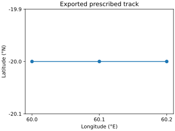

Follow a moving region
======================

Use a supplied geographical track to extract a native-grid window at each time.
Start in the directory from :doc:`generate_fixtures`.

Select a trajectory
--------------------

Save :download:`moving-region.yaml <../../../example/tutorials/moving-region.yaml>`:

.. literalinclude:: ../../../example/tutorials/moving-region.yaml
   :language: yaml

The generated track moves east by 0.1° each hour. Each position selects a
grid-aligned crop; fields are not interpolated onto the continuous centre.
``track: true`` also exports that trajectory for other tools.

The default exact time association requires a centre at each selected input
time. It does not interpolate missing centres. See
:doc:`../tracker/prescribed_track` for the trajectory file contract and
:doc:`../concepts/time_support` for other association policies.

.. _check-and-run:

Run
----

.. container:: frameit-tabs

   .. container:: frameit-tab

      .. rubric:: CLI

      .. code-block:: bash

         frameit run moving-region.yaml

   .. container:: frameit-tab

      .. rubric:: Python API

      .. code-block:: python

         from frameit.core.execution import execute_simulation
         from frameit.core.settings_class import SimulationConfig

         config = SimulationConfig.from_yaml_with_model_preset("moving-region.yaml")
         result = execute_simulation(config)
         print(result.products)

View the output
----------------

The run writes a model-grid pressure file and a track file.
Copy this into ``plot_moving_region.py``:

.. literalinclude:: ../../../example/plots/plot_moving_region.py
   :language: python

Optional: :download:`script file <../../../example/plots/plot_moving_region.py>`.

.. code-block:: bash

   python plot_moving_region.py results/moving-region/products/moving-region.track.nc moving-region.svg

   Exported geographical positions, not native ``cx/cy`` indices.

Write a track from a table
--------------------------

If your known positions are in a table, write them to a NetCDF file first.
FrameIt needs one latitude and longitude for each time. This script uses
the same three positions as the tutorial. It writes two new files and does
not change ``data/track.nc``.

Copy this into ``write_table_track.py`` and run ``python write_table_track.py``:

.. literalinclude:: ../../../example/tutorials/write_table_track.py
   :language: python

Optional: :download:`script file <../../../example/tutorials/write_table_track.py>`.

Copy ``moving-region.yaml`` to ``table-region.yaml``. In the copy, set:

* ``run.name`` to ``table-region``;
* ``region.track.file`` to ``./table-track.nc``;
* ``output.directory`` to ``./results/table-region``.

Run ``frameit run table-region.yaml``. The exported track has the same
three times and positions as the first run.

To see a missing-centre error, copy that request to ``gap-region.yaml``.
Set ``region.track.file`` to ``./table-track-gap.nc`` and
``output.directory`` to ``./results/gap-region``. Run
``frameit validate gap-region.yaml``. It reports :ref:`E1404 <e1404>` because
the new track has no position at 01:00.

Adapt to real inputs
---------------------

Replace the fields, trajectory and full crop widths. Check that the track
times use the same convention as your data. Use geographical positions, not
grid indices from another run. FrameIt does not fill gaps in the track.
If you do not have a trajectory, see :doc:`calculate_track`.
