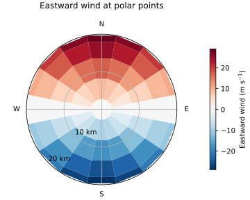

Sample a polar grid
===================

Sample an eastward wind component around a fixed centre. Start in the directory
from :doc:`generate_fixtures`. Polar processing runs only because this request
selects it.

Select the polar product
------------------------

Save :download:`polar-sampling.yaml <../../../example/tutorials/polar-sampling.yaml>`:

.. literalinclude:: ../../../example/tutorials/polar-sampling.yaml
   :language: yaml

Omitting ``radial_step_km`` derives a supported step from the prepared input
coordinates. An explicit smaller-than-supported step fails with the calculated
minimum. The bound depends on the selected grid, not a model's nominal resolution.

Continuous fields use bilinear point sampling by default, without an
area-conservation guarantee. The default strict missing-data policy leaves
insufficiently supported points missing. The field stays eastward wind:
polar sample locations do not make it radial wind or subtract centre motion.

Run
----

.. container:: frameit-tabs

   .. container:: frameit-tab

      .. rubric:: CLI

      .. code-block:: bash

         frameit run polar-sampling.yaml

   .. container:: frameit-tab

      .. rubric:: Python API

      .. code-block:: python

         from frameit.core.execution import execute_simulation
         from frameit.core.settings_class import SimulationConfig

         config = SimulationConfig.from_yaml_with_model_preset("polar-sampling.yaml")
         result = execute_simulation(config)
         print(result.products)

View the output
----------------

The run exports native-grid and polar files. Copy this into ``plot_polar_sampling.py``:

.. literalinclude:: ../../../example/plots/plot_polar_sampling.py
   :language: python

Optional: :download:`script file <../../../example/plots/plot_polar_sampling.py>`.

.. code-block:: bash

   python plot_polar_sampling.py results/polar-sampling/products/polar-sampling.atmosphere.polar.nc polar-sampling.svg

   First output time. The circular display retains the eastward component;
   it does not turn it into radial wind.

Use the output's validity, support-fraction and interpolation-status variables
when analysing missing samples; see :doc:`../concepts/missingness_and_status`.

Adapt to real inputs
---------------------

Replace the input and centre; choose radius and azimuth count for the intended
analysis. Declare unresolved field kind and wind basis from input evidence.
See :doc:`../reference/polar` for methods, budgets and limitations.
