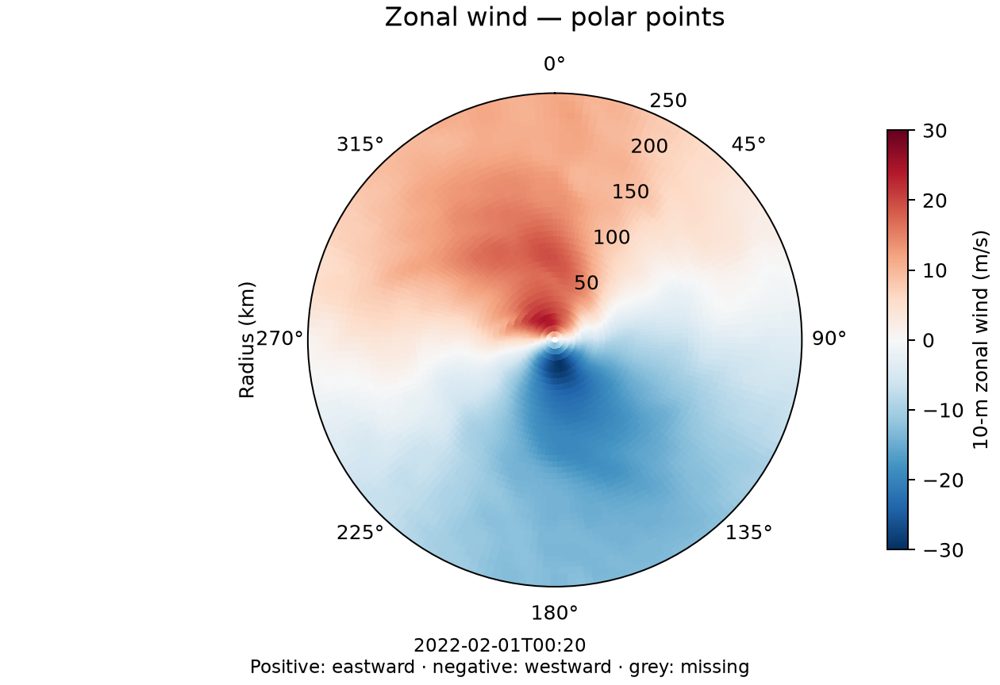

Sample selected fields on a polar grid
======================================

Use polar point samples for radial/angular comparisons around a continuous
geographical centre. They are not cell averages or a conservative area remap.
The reference environment supplies the optional xESMF/ESMF stack; native
extraction remains usable without it.

Create a small instructional input in a new directory:

.. code-block:: bash

   mkdir frameit-polar-scalar
   cd frameit-polar-scalar
   python -m frameit.testing.documentation_example --output data/first-run.nc

The two-time scalar has a valid zero and one missing sample per time. It has
no physical meaning and is not a real-producer qualification.
Save this complete request as ``frameit.yaml``:

.. code-block:: yaml

   schema_version: 3
   run:
     name: polar-scalar
   sources:
     atmosphere:
       model: arome
       files: ./data/first-run.nc
       variables:
         2d: [instructional_scalar]
       field_metadata:
         instructional_scalar:
           kind: continuous
           temporal_kind: instantaneous
   region:
     center: {latitude: -20, longitude: 60}
   products:
     polar:
       radius_km: 2
       radial_step_km: 1.5
       azimuth_count: 8
   output:
     directory: ./results/polar-scalar

Only the polar product is requested: no model-grid crop or width is needed.
``radius_km`` gives the outer radius independently of any model-grid extent.
This example has radii 0, 1.5 and 2 km; its shorter last interval reaches the
exact outer radius. Eight angles cover 0 through 315 degrees clockwise from
north without duplicating 360 degrees. ``radius`` is in kilometres and ``azimuth``
in radians, with a degree helper ``azimuth_degrees``.

The declared continuous kind selects bilinear interpolation. Omitted coverage
policy is ``strict``. A real input needs evidence for its kind, units, geometry
and time meaning; do not copy this scalar's declarations onto unrelated fields.
Omitted radial step uses native spacing; a finer-than-supported step fails.
The resolved spacing uses the larger horizontal-axis median, then the coarsest
participating prepared grid. Denser targets do not add source resolution.
Omitted angle count uses the documented outer-ring spacing rule.
See :doc:`../polar_projection/xESMF_proj` for the numerical details.

   Real-data example, separate from the instructional settings above: BATSIRAI
   uses 6 km radial spacing and 180 azimuths. Colours show stored eastward wind
   in m/s, not radial wind. See the
   :doc:`Cartesian comparison <../polar_projection/xESMF_proj>` and the
   :doc:`data conventions and standalone script <../reference/illustrations>`.

Choose coverage deliberately
----------------------------

``strict`` requires every contributing sample to be finite. Explicit
``renormalize`` accepts partial support only at the declared valid-weight
threshold. Neither fills an unmapped or all-missing point. Proven categorical
fields use nearest-neighbour sampling, not bilinear mixing. Unresolved kind fails.

For an explicit partial-support choice, add this fragment **inside the existing
``products.polar`` mapping**:

.. code-block:: yaml

   field_options:
     atmosphere:
       instructional_scalar:
         missing_data_policy: renormalize
         min_valid_weight_fraction: 0.75

The threshold is a scientific choice, not a repair for missing values.
Per-field options can also target internal U/V inputs needed by a requested
speed. They do not request exports; unused or inapplicable options fail.
Use ``interpolation: nearest`` for an admitted nearest-neighbour override.
Nearest-neighbour does not use partial-stencil renormalization.
It is restricted to the ESMF spherical source-cell footprint, not extrapolated
outside the source. Determining that footprint requires an extra geometry-only
bilinear weight build for a nearest plan.

FrameIt resolves polar input support separately from model-grid export. Changing
only the crop width cannot move the target or remove its needed neighbours.
Insufficient configured support fails; targets outside the actual source can
still be unmapped. A larger halo is not extrapolation.

Selecting U/V alone does not request speed or radial/tangential winds. A requested
``wind_speed`` samples its prepared components before calculating magnitude.
Polar W keeps its native vertical locations unless its own field option requests
supported mass sampling. It does not inherit a model-grid export transform.
See :doc:`scalars_and_vectors` for units, basis and quantity distinctions.

Check, run and read
-------------------

Execute the request through the Python API:

.. code-block:: python

   from frameit.core.execution import execute_simulation
   from frameit.core.settings_class import SimulationConfig

   config = SimulationConfig.from_yaml("frameit.yaml")
   result = execute_simulation(config)
   print(result.products)

Reopen the source-qualified polar product without importing FrameIt:

.. code-block:: python

   import numpy as np
   import xarray as xr

   with xr.open_dataset(
       "results/polar-scalar/products/polar-scalar.atmosphere.polar.nc"
   ) as out:
       np.testing.assert_array_equal(out.radius, [0, 1.5, 2])
       np.testing.assert_allclose(out.azimuth, np.arange(8) * np.pi / 4)
       np.testing.assert_array_equal(out.azimuth_degrees, np.arange(8) * 45)
       np.testing.assert_allclose(
           out.instructional_scalar.isel(radius=0),
           np.broadcast_to([[0.], [1000.]], (2, 8)), atol=1e-9, rtol=0)
       print(out.instructional_scalar.attrs)
       print(out.instructional_scalar_geometry_mapped)
       print(out.instructional_scalar_support_fraction)
       print(out.instructional_scalar_interpolation_status)

Check the target counts, actual coordinates and each field's support/status
alongside its values. The valid central zero must not become missing, and missing
contributors must not become physical zero. Ordinary ring means/FFTs require
complete endpoint-exclusive rings; partial-sector analysis needs an explicit
coverage choice and can be biased. No track motion is subtracted.
Each field has its own geometry flag; global ``geometry_mapped`` is the
intersection of those flags, not a common source mask. Speed attributes record
component policies in JSON ``polar_component_options``; its support is the
minimum component support and validity requires both sampled components.
For multiple sources, read :doc:`coupled_inputs` before requesting a shared target.
