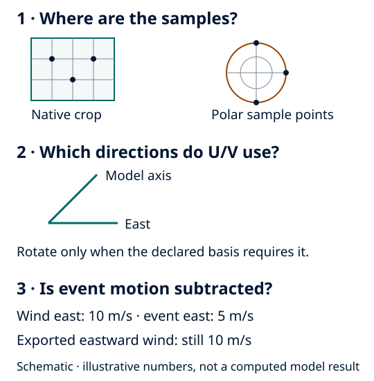

Choose scalar and vector representations
========================================

Field names alone do not establish quantity, sampling location or vector basis.
Inspect :ref:`source metadata and producer conventions <wind-metadata>` before
requesting an operation.

Copy native components
-----------------------

This complete request copies two existing levels of one Meso-NH component.
Replace the illustrative path, field and indices with those in your input:

.. code-block:: yaml

   schema_version: 3
   run:
     name: native-component
   sources:
     atmosphere:
       model: mesonh
       files: ./data/mnh*.nc
       variables:
         3d: [UT]
         levels: {indices: [2, 0]}
   output:
     directory: ./results/native-component

No wind pair is needed for native copying. Values, units, staggering and masks
stay native; the unselected V component is not required. Selecting both U and V
still does not calculate speed or radial/tangential winds.

.. _declare-atmospheric-wind-pairs:

Request a model-grid transform
------------------------------

Source ``transforms`` target explicit exported fields. Sampling, vector basis
and units are separate choices. This fragment supplements the request above,
selecting U/V/W and moving them to mass points. It also rotates U/V to east/north
and explicitly converts their velocity units:

.. code-block:: yaml

   sources:
     atmosphere:
       variables:
         3d: [UT, VT, WT]
         levels: {indices: [2, 0]}
       wind_pairs:
         - u: UT
           v: VT
           basis: grid
           rotation: {method: mesonh_projection}
       transforms:
         - fields: [UT, VT]
           sampling: mass
           basis: earth
           units: m s-1
         - fields: [WT]
           sampling: mass
           units: m s-1

Here ``basis: grid`` describes stored U/V directions; ``basis: earth`` requests
eastward/northward output. This example requires the applicable Meso-NH
``BETA``, ``RPK`` and ``LON0``. Missing or conflicting geometry fails. Supply
producer-confirmed parameters only; see :ref:`missing-mesonh-wind-projection`
for the narrow existing exception and its responsibilities.

An explicit remap selects levels on its destination axis. Required native
neighbours remain internal; they do not add exported levels. W remapping is
independent of U/V rotation and does not turn pressure velocity into geometric
velocity. Mass points are model cell centres, not fixed heights.
The example's ``WT`` conversion to m s-1 requires geometric vertical velocity
in compatible units. Pressure velocity in Pa s-1 cannot use that conversion;
remapping its sample locations must retain its pressure-velocity units.
See :ref:`wind-grid-contract` for C-grid/W diagrams and boundary rules.

Calculate only a requested result
---------------------------------

This complete request calculates a speed from inspected eastward/northward
10-m components. It does not export the input components:

.. code-block:: yaml

   schema_version: 3
   run:
     name: horizontal-speed
   sources:
     atmosphere:
       model: mesonh
       files: ./data/mnh*.nc
       wind_pairs:
         - u: UM10
           v: VM10
           basis: earth
       derived:
         speed:
           method: wind_speed
           inputs: {u: UM10, v: VM10}
   products:
     model_grid:
       fields: {atmosphere: [speed]}
   output:
     directory: ./results/horizontal-speed

``wind_speed`` uses collocated, physically compatible components and reports
m s-1. It is not ``hypot`` of two staggered face arrays. The method prepares its
own required inputs; a model-grid export transform does not change another
calculation, tracker or polar preparation.
Output-name collisions, incompatible units and unavailable support fail.
Definitions excluded from all requested products and dependencies do not execute.

   Schematic. Sample locations, vector basis and reference-frame motion are
   different choices. Storm-centred polar positions do not subtract storm motion
   from the winds.

Check the result
----------------

Check metadata with ``frameit validate`` and ``frameit run --dry-run`` before
``frameit run``. Reopen the source-qualified model-grid output with an ordinary
reader. Check each field's values, dimensions, native indices, coordinates,
units, basis and recorded method. Internal-only companions must not appear as
extra physical outputs.
Public model-grid axes use the :ref:`output coordinate names
<model-grid-coordinate-names>`. Native copying preserves sample locations and
values, not necessarily the source file's dimension labels. Use retained native
coordinate/index auxiliaries when you need the original source positions.

Ocean component operations keep their adapter-specific angle, mask, bracket and
quantity requirements. Atmospheric declarations do not supply missing ocean
geometry or make currents into atmospheric winds.
See :doc:`../user_guide/ocean_netcdf` for the admitted source limits.
