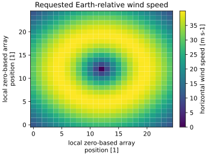

Choose scalar and vector representations
========================================

Copy native components or explicitly request a derived wind speed.
Start in the directory from :doc:`generate_fixtures`.

.. _declare-atmospheric-wind-pairs:

Declare the components
----------------------

Save :download:`scalars-and-vectors.yaml <../../../example/tutorials/scalars-and-vectors.yaml>`:

.. literalinclude:: ../../../example/tutorials/scalars-and-vectors.yaml
   :language: yaml

The fixture's U/V components are collocated and Earth-relative.
``basis: earth`` declares their east/north directions; it does not rotate values.
The selected ``speed`` result is their magnitude in m s-1.
Copying native components alone needs no wind pair and does not calculate speed.

Sampling locations, basis rotation and subtraction of centre motion are separate
operations. See :ref:`wind-grid-contract` for native/mass locations and
:doc:`../reference/polar` for explicitly requested polar wind methods.

Run
----

.. container:: frameit-tabs

   .. container:: frameit-tab

      .. rubric:: CLI

      .. code-block:: bash

         frameit run scalars-and-vectors.yaml

   .. container:: frameit-tab

      .. rubric:: Python API

      .. code-block:: python

         from frameit.core.execution import execute_simulation
         from frameit.core.settings_class import SimulationConfig

         config = SimulationConfig.from_yaml_with_model_preset("scalars-and-vectors.yaml")
         result = execute_simulation(config)
         print(result.products)

View the output
----------------

Copy this into ``plot_scalars_and_vectors.py``:

.. literalinclude:: ../../../example/plots/plot_scalars_and_vectors.py
   :language: python

Optional: :download:`script file <../../../example/plots/plot_scalars_and_vectors.py>`.

.. code-block:: bash

   python plot_scalars_and_vectors.py results/scalars-and-vectors/products/scalars-and-vectors.atmosphere.model_grid.nc scalars-and-vectors.svg

   Requested speed. The exported U/V components retain their Earth-relative basis.

.. _prepare-interface-input:

For an explicit interface-to-mass W example, the generated ``interfaces.nc``
also works with
:download:`analytic-interfaces.yaml <../../../example/tutorials/analytic-interfaces.yaml>`.
Native index 1 is W=0.5 m s-1 at 500 m; its explicitly requested polar mass
index 1 is W=1 m s-1 at 1000 m. Equal index numbers do not mean equal locations.
See :doc:`../reference/vertical_levels` for selection on destination grids.

Adapt to real inputs
---------------------

Replace names and verify units, staggering and vector basis from producer
metadata. Grid-relative winds need evidenced rotation; changing a label to
``earth`` is not a conversion. A W remap retains its physical quantity and units.
