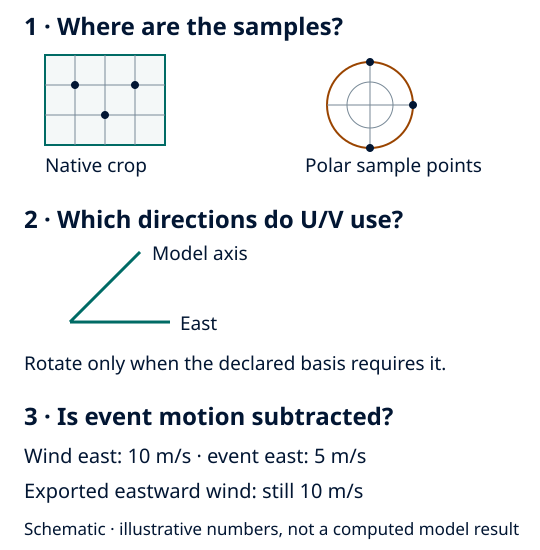

Choose scalar and vector representations
========================================

Start from an inspected stream and its matching starter:

.. code-block:: bash

   frameit init mesonh-pressure-wind

Adapt paths, selected fields and domain. Scalar copies retain source units;
prepared atmospheric velocities use m s-1. Field names alone do not establish
quantity, sample location or vector basis.

Declare atmospheric wind pairs
------------------------------

For native Meso-NH ``UT/VT`` and Earth-relative ``UM10/VM10``, declare each pair
separately. This fragment assumes the inspected projection metadata establishes
the native grid rotation:

.. code-block:: yaml

   input:
     wind_pairs:
       - group: level
         u: UT
         v: VT
         reference_frame: grid
         rotation: {method: mesonh_projection}
       - group: fields_2d
         u: UM10
         v: VM10
         reference_frame: earth
   output:
     cartesian:
       horizontal_vectors: earth_centered
       vertical_velocity: interfaces
     polar:
       vertical_velocity: mass

``earth_centered`` collocates atmospheric U/V and rotates grid-relative pairs to
east/north. ``native`` retains their source staggering and declared basis, with
normalized velocity units. W location is an independent choice. Tracking and
polar processing use a separate analysis representation, so changing Cartesian
representation does not change their results. See :ref:`wind-grid-contract`
for existing C-grid/W diagrams, level mapping and method limitations.

   Schematic. Sample locations, vector basis and reference-frame motion are
   different choices. Storm-centred polar positions retain Earth-relative winds.

Check the result
----------------

Run ``frameit validate``, ``frameit run --dry-run`` and ``frameit run``. Reopen the
selected products and check each component's dimensions, coordinates, units and
basis. Do not take ``hypot`` of staggered face arrays as though they were a
collocated point vector. A requested ``wind_speed`` uses the prepared pair and
does not export internal-only companions.

For native ocean components, select ``horizontal_vectors: native`` unless the
documented CROCO rho/Earth analysis is intended and its angle/mask/bracket
requirements are met. NEMO component analysis and ocean wind diagnostics are
unsupported. See :doc:`../user_guide/ocean_netcdf`; atmospheric wind declarations
do not supply missing ocean geometry or physical meaning.
