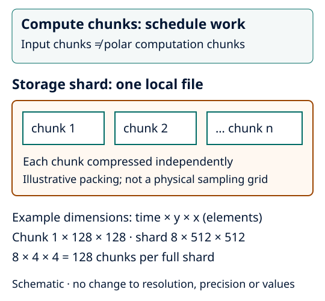

Choose storage and resource limits
==================================

Start from a complete request, such as :doc:`fixed_region`. Use a fresh
``output.directory`` and keep ``overwrite: false``.

NetCDF is the default; choose Zarr only
when your downstream reader supports sharded v3 stores. The reference environment
includes both. Core-only installations need the optional ``zarr`` extra for Zarr
export; see :ref:`sharded-zarr-output` for versions and ordinary-reader examples.

Separate the three chunk choices
--------------------------------

   Schematic. Compute chunks schedule work; storage chunks encode values; shards
   group storage chunks into fewer files. None changes scientific resolution.

* ``sources.<id>.reader.chunks`` uses native source dimension names and is applied
  after time/level selection. A whole-axis ``-1`` can increase a task's working set.
* Product ``processing.chunks`` uses public product axes:
  ``products.model_grid.processing.chunks`` for model-grid blocks, or
  ``products.polar.processing.chunks`` for ``radius/azimuth`` and leading
  dimensions such as ``height_above_ground``.
* ``output.writer.chunks`` and ``output.writer.shards`` control storage in
  **elements**, not bytes. Shards apply only to Zarr.

Start with defaults. For example, a Zarr time chunk of 1 and spatial chunks of
128×128 can be packed in a shard of 8×512×512: 128 chunks per full shard.
Explicit shard extents must be multiples of explicit chunk extents. Use actual
output dimensions (for example ``y/x`` or ``radius/azimuth``), not input dimension
names. A key may apply to only some field datasets; a key matching none fails.
See :ref:`model-grid-coordinate-names` for staggered/ocean grids.
Large shards can increase write memory. See :doc:`../user_guide/output_files`
for automatic layouts and the directory-replacement visibility limit.

Cap concurrency before tuning
-----------------------------

This fragment supplements a complete request such as :doc:`fixed_region`:

.. code-block:: yaml

   resources:
     cpus: 1
     scheduler: synchronous
     native_threads: 1
     synchronous_export: true
     export_workers: 1

This is a bounded pilot, not a universal fastest configuration. Omit ``cpus`` to
use the strictest detected machine, affinity and Slurm limit. Explicit requests
above that limit fail. Readers run serially; compute and export use successive
phases. Export workers × compute workers × native threads must fit the budget.
Inactive synchronous pools count as one.

The defaults use one native thread and spawned export processes.
``synchronous_export: true`` avoids the export pool without changing sampling.
Python scripts using spawned export need an ``if __name__ == "__main__":`` guard;
see :doc:`../getting_started/hpc`.

.. code-block:: bash

   frameit validate
   frameit config show frameit.yaml --effective
   frameit run

Inspect effective worker counts and setting origins, planned products and polar
geometry points. ``run-provenance.yaml`` records actual input/product chunk
applications; published field descriptors record the stored chunks and shards.
``products.polar.processing.max_target_points`` bounds target geometry, not every variable/level array or
peak memory. FA decode budgets can apply to a full native horizontal record even
for a small crop. Measure whole-run wall time, peak memory and I/O with the same
selection and numerical checks before increasing concurrency. Use
:doc:`../getting_started/hpc` for site-neutral Slurm launchers and retry policy.

.. _execution-progress:

Read execution progress
-----------------------

Progress identifies the operation and source when known, completed counts,
elapsed time and time since the last recorded activity. At ``INFO``, repeated
notices appear no more than once every 30 seconds, plus start and terminal
messages. They follow the selected logging level. Logs go to standard error
and, after run ownership is established, the run's log file.

Preparing lazy fields or calculation graphs is not completed computation.
Computing and writing may happen together during export. Published-product
counts increase only after a complete product is observed, not when a worker
is scheduled. Quiet notices do not increase counts or reset the last activity.

A notice shows that the reporter can run, not that a native calculation is
advancing. A blocked interpreter or logging call can delay notices.
Read ``run-status.yaml`` for the final execution state and actual inventory;
progress messages are not scientific validation. See
:doc:`../user_guide/output_files` for incomplete and failed attempts.
