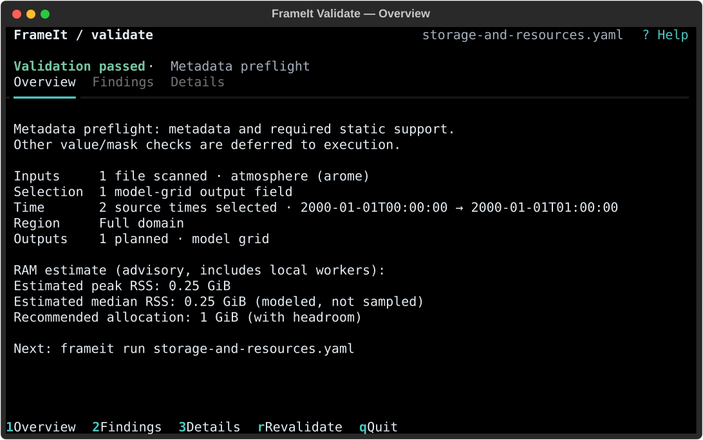

Choose storage and resource limits
==================================

Write the generated scalar to sharded Zarr v3 and bound the small run to one
CPU. Start in the directory from :doc:`generate_fixtures`; use the reference
environment's compatible Zarr/xarray versions.

Select storage
---------------

Save :download:`storage-and-resources.yaml <../../../example/tutorials/storage-and-resources.yaml>`:

.. literalinclude:: ../../../example/tutorials/storage-and-resources.yaml
   :language: yaml

Stored chunk/shard extents count elements. Shards must be multiples of chunks.
These storage choices do not change values, masks or scientific resolution.
NetCDF is the default if ``format`` is omitted.
Without overrides, Zarr blocks the spatial axes of each exported grid while
keeping other scientific axes, such as depth and ensemble member, separate.
Use the actual exported dimension names when overriding the layout.

Post-run diagnostic buffers
---------------------------

The extraction RAM estimate is not a diagnostic limit. ``run-diag --check``
reports the requested working buffers, selected decode units and unestimated
backend overhead. ``working_memory_mib`` defaults to 256 MiB; it is not a
guaranteed RSS limit. A tile can require a whole GRIB message or a larger
Zarr storage unit. Diagnostic execution is serial. See
:doc:`../diagnostics/index` before choosing the source representation.

Input-reader chunks schedule source reads; product processing chunks schedule
calculations; output chunks/shards encode storage. See
:ref:`sharded-zarr-output` for layouts, reader requirements and replacement limits.
The one-CPU settings here are a bounded tutorial, not a fastest configuration.

.. _estimate-run-ram:

Estimate RAM before a run
--------------------------

In an interactive terminal, run full validation with the resources and output
settings you plan to use:

.. code-block:: bash

   frameit validate storage-and-resources.yaml

Open **Overview** (press ``1``). Scroll below **Outputs** to **RAM estimate**.
**Recommended allocation is 1.5× the estimated peak RSS, rounded up to a
whole GiB.**

   Validate Overview for the instructional fixture. The RAM section appears
   after validation has bound the inputs and products.

For the same figures without the terminal view, run:

.. code-block:: bash

   frameit validate storage-and-resources.yaml --cli

FrameIt estimates peak RSS from the bound input sizes, processing and output
buffers, and simultaneous local workers.
Writer buffers include the bound ensemble dimensions. Polar interpolation can
combine several reader chunks. If the stencil window is not known at validation,
the estimate budgets the full prepared source plane.
The reported median is the median of modeled typical phase budgets, not a
sample across the runtime of a job. The estimate sums RSS across processes,
which can count shared pages more than once. It is not Slurm's ``MaxRSS``.

``--json`` includes the approximate byte counts and phase breakdown under
``data.plan.memory_estimate``. Schema-only validation and unresolved plans
cannot recommend an allocation. Validation does not run the workload to
measure RAM. Backend caches, compression and realized processing costs vary;
check a representative pilot before sizing a production run.
