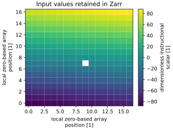

Choose storage and resource limits
==================================

Write the generated scalar to sharded Zarr v3 and bound the small run to one
CPU. Start in the directory from :doc:`generate_fixtures`; use the reference
environment's compatible Zarr/xarray versions.

Select storage
---------------

Save :download:`storage-and-resources.yaml <../../../example/tutorials/storage-and-resources.yaml>`:

.. literalinclude:: ../../../example/tutorials/storage-and-resources.yaml
   :language: yaml

Stored chunk/shard extents count elements. Shards must be multiples of chunks.
These storage choices do not change values, masks or scientific resolution.
NetCDF is the default if ``format`` is omitted.

Input-reader chunks schedule source reads; product processing chunks schedule
calculations; output chunks/shards encode storage. See
:ref:`sharded-zarr-output` for layouts, reader requirements and replacement limits.
The one-CPU settings here are a bounded tutorial, not a fastest configuration.

Run
----

.. container:: frameit-tabs

   .. container:: frameit-tab

      .. rubric:: CLI

      .. code-block:: bash

         frameit run storage-and-resources.yaml

   .. container:: frameit-tab

      .. rubric:: Python API

      .. code-block:: python

         from frameit.core.execution import execute_simulation
         from frameit.core.settings_class import SimulationConfig

         config = SimulationConfig.from_yaml_with_model_preset("storage-and-resources.yaml")
         result = execute_simulation(config)
         print(result.products)

.. _execution-progress:

Read progress
--------------

Progress reports execution activity, not scientific validation. Read
``run-status.yaml`` for completed products and
:doc:`../user_guide/output_files` for failed/incomplete attempts.

View the output
----------------

Copy this into ``plot_storage_and_resources.py``:

.. literalinclude:: ../../../example/plots/plot_storage_and_resources.py
   :language: python

Optional: :download:`script file <../../../example/plots/plot_storage_and_resources.py>`.

.. code-block:: bash

   python plot_storage_and_resources.py results/storage-and-resources/products/storage-and-resources.atmosphere.model_grid.zarr storage-and-resources.svg

   Ordinary xarray reopening retains the input values, including zero and NaN.

Adapt to real inputs
---------------------

Replace the source and fields; choose storage supported by downstream readers.
Measure a bounded pilot before increasing concurrency. Scripts using spawned
export workers need a main guard; see :doc:`../getting_started/hpc`.
