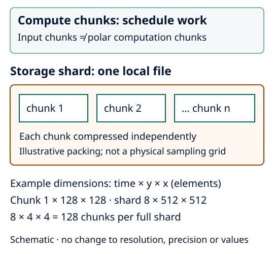

Choose storage and resource limits
==================================

Begin with a small field/time/level selection in a fresh output directory:

.. code-block:: bash

   frameit init arome-fixed-scalar

Keep the generated overwrite refusal. NetCDF is the default; choose Zarr only
when your downstream reader supports sharded v3 stores. The reference environment
includes both. Core-only installations need the optional ``zarr`` extra for Zarr
export; see :ref:`sharded-zarr-output` for versions and ordinary-reader examples.

Separate the three chunk choices
--------------------------------

   Schematic. Compute chunks schedule work; storage chunks encode values; shards
   group storage chunks into fewer files. None changes scientific resolution.

* ``input.netcdf.chunks`` uses source dimension names; ``{}`` respects native
  storage chunks. A whole-axis ``-1`` can read far more than a small crop needs.
* ``polar.chunks`` controls polar result computation using its dimension names.
* ``output.zarr_chunk_size`` and ``output.zarr_shard_size`` control Zarr storage
  in **elements**, not bytes. NetCDF storage chunks are backend-selected.

Start with defaults. For example, a Zarr time chunk of 1 and spatial chunks of
128×128 can be packed in a shard of 8×512×512: 128 chunks per full shard.
Explicit shard extents must be multiples of explicit chunk extents. Use actual
output dimensions (``x_box/y_box`` or ``rr/theta``); absent dimensions are ignored.
Large shards can increase write memory. See :doc:`../user_guide/output_files`
for automatic layouts and the directory-replacement visibility limit.

Cap concurrency before tuning
-----------------------------

.. code-block:: yaml

   execution:
     dask_scheduler: synchronous
     native_threads: 1
   output:
     synchronous_export: true
     max_workers: 1

This is a bounded pilot, not a universal fastest configuration. Threaded Dask
work, native threads and spawned export processes share the CPU budget. Requests
above affinity/machine/Slurm limits fail. ``synchronous_export`` avoids the export
pool; it does not change sampling or select a different numerical method.

.. code-block:: bash

   frameit validate
   frameit run --dry-run
   frameit run

Inspect effective worker counts, planned products and polar geometry points.
``polar.max_points`` bounds target geometry, not every variable/level array or
peak memory. FA decode budgets can apply to a full native horizontal record even
for a small crop. Measure whole-run wall time, peak memory and I/O with the same
selection and numerical checks before increasing concurrency. Use
:doc:`../getting_started/hpc` for site-neutral Slurm launchers and retry policy.
