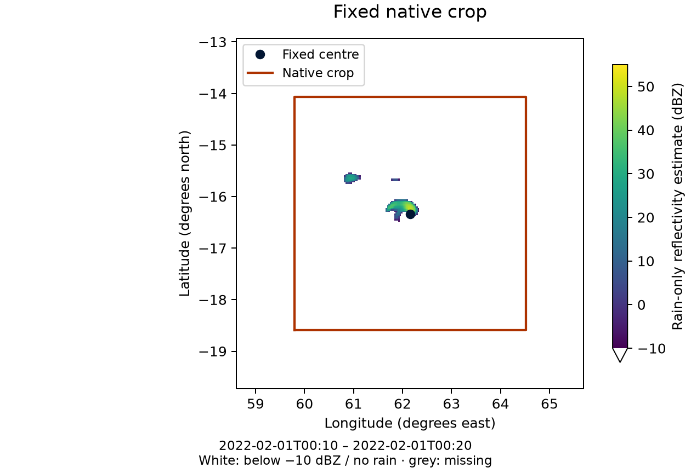

Fixed-box method
================

For a worked run, use :doc:`../task_guides/fixed_region`.

Overview
--------

``tracking.method: fixed_box`` keeps one geographical centre at every time.
FrameIt selects its native grid indices once and repeats them along the time axis.
The requested latitude/longitude remain the polar origin.

This option is useful when:

- the region of interest is fixed (site-focused diagnostics),
- tracking variables (MSLP, winds) are not available or not reliable.

Inputs and outputs
------------------

Input dataset
~~~~~~~~~~~~~

The model dataset must provide:

- a time coordinate named ``time``,
- latitude and longitude coordinates, either:
  - 1D latitude and 1D longitude (typical AROME-like rectilinear grid), or
  - 2D latitude and 2D longitude (typical Meso-NH curvilinear grid).

Configuration
-------------

Minimal configuration
~~~~~~~~~~~~~~~~~~~~~

.. code-block:: yaml

   tracking:
     method: fixed_box
     fixed_box:
       center: {latitude: -17.5, longitude: 60.0}  # Degrees north/east

Algorithm
---------

For NetCDF/GRIB and regular lon/lat FA, FrameIt minimizes squared distance in
latitude/longitude space, with longitude differences wrapped modulo 360.
Projected FA uses :doc:`source-CRS axes <../user_guide/fa_geometry>` instead.

Rectilinear grid (latitude 1D, longitude 1D)
~~~~~~~~~~~~~~~~~~~~~~~~~~~~~~~~~~~~~~~~~~~~~~~~~~

If latitude and longitude are 1D arrays:

.. code-block:: text

   cy = argmin_j (lat[j] - lat0)^2
   cx = argmin_i wrap(lon[i] - lon0)^2

Curvilinear grid (latitude 2D, longitude 2D)
~~~~~~~~~~~~~~~~~~~~~~~~~~~~~~~~~~~~~~~~~~~~~~~~~~

If latitude and longitude are 2D arrays:

.. code-block:: text

   dist2(j, i) = (lat(j, i) - lat0)^2 + wrap(lon(j, i) - lon0)^2
   (cy, cx) = argmin_{j,i} dist2(j, i)

Output
~~~~~~

The index pair ``(cy, cx)`` is repeated for each model timestamp, producing:

- ``cy(time) = constant``
- ``cx(time) = constant``

Example
-------

.. code-block:: yaml

   model: mesonh
   tracking:
     method: fixed_box
     fixed_box:
        center: {latitude: -16.342215392786485, longitude: 62.15487544109405}
   domain:
     width_km: {x: 500, y: 500}

Illustration
------------

Fixed-box extraction from the real BATSIRAI rainfall fields:

   The outline follows the selected native indices, not a continuously recentered
   box. Colours are an **illustrative rain-only estimate**, derived externally from
   accumulated rainfall, not stored model reflectivity. See the
   :doc:`formula, limits and regeneration script <../reference/illustrations>`.

Known limitations
------------------

* **Not event detection:** the centre stays fixed even if the event leaves the box.
* **Grid-aligned extraction:** a native point supplies ``cx/cy``. Requested widths
  round to native point counts; neither location nor extent is imposed by regridding.
  The requested geographical centre remains the polar origin.
* **Lookup convention:** ordinary geographic lookup uses squared degrees, not
  geodesic distance. Admitted projected FA uses its declared source CRS.
* **Coverage:** no finite geographical candidate causes failure. A crop extending
  beyond the model boundary retains its shape with NaN padding.
* **Stationary geometry:** this lookup does not implement an evolving source mesh.
