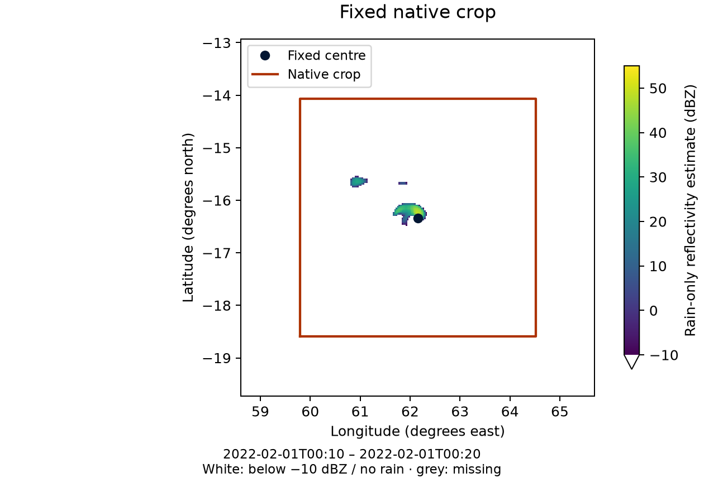

Fixed-box method
================

For a worked run, use :doc:`../task_guides/fixed_region`.

Overview
--------

``region.center`` keeps one geographical centre at every selected source time.
FrameIt selects its native grid indices once and repeats them along the time axis.
The requested latitude/longitude remain the polar origin.

This option is useful when:

- the region of interest is fixed (site-focused diagnostics),
- tracking variables (MSLP, winds) are not available or not reliable.

Inputs and outputs
------------------

Input dataset
~~~~~~~~~~~~~

Each source adapter must identify its own selected sample clock and native
geography. On a stationary grid, supported geography includes:

- 1D latitude and 1D longitude axes;
- matching 2D latitude and longitude grids.

Fixed geometry needs no atmospheric reference source. The geographical request
is applied independently to every required source, without intersecting clocks.

Configuration
-------------

Minimal configuration
~~~~~~~~~~~~~~~~~~~~~

Region fragment; the complete source request is in
:doc:`../task_guides/fixed_region`:

.. code-block:: yaml

   region:
     center: {latitude: -17.5, longitude: 60.0}  # Degrees north/east
     width_km: {x: 400, y: 400}

Algorithm
---------

For NetCDF/GRIB and regular lon/lat FA, FrameIt minimizes squared distance in
latitude/longitude space, with longitude differences wrapped modulo 360.
Projected FA uses :doc:`source-CRS axes <../user_guide/fa_geometry>` instead.

Rectilinear grid (latitude 1D, longitude 1D)
~~~~~~~~~~~~~~~~~~~~~~~~~~~~~~~~~~~~~~~~~~~~~~~~~~

If latitude and longitude are 1D arrays:

.. code-block:: text

   cy = argmin_j (lat[j] - lat0)^2
   cx = argmin_i wrap(lon[i] - lon0)^2

Curvilinear grid (latitude 2D, longitude 2D)
~~~~~~~~~~~~~~~~~~~~~~~~~~~~~~~~~~~~~~~~~~~~~~~~~~

If latitude and longitude are 2D arrays:

.. code-block:: text

   dist2(j, i) = (lat(j, i) - lat0)^2 + wrap(lon(j, i) - lon0)^2
   (cy, cx) = argmin_{j,i} dist2(j, i)

Output
~~~~~~

The index pair ``(cy, cx)`` is repeated for each model timestamp, producing:

- ``cy(time) = constant``
- ``cx(time) = constant``

Example
-------

For an inspected Meso-NH source, this region fragment selects a 500-km native box:

.. code-block:: yaml

   region:
      center: {latitude: -16.342215392786485, longitude: 62.15487544109405}
      width_km: {x: 500, y: 500}

Illustration
------------

Fixed-box extraction of the real BATSIRAI 10-m zonal wind:

   The outline follows the selected native indices, not a continuously recentered
   box. Colours show stored eastward wind in m/s; negative values are westward.
   See the :doc:`data conventions and regeneration script <../reference/illustrations>`.

Known limitations
------------------

* **Not event detection:** the centre stays fixed even if the event leaves the box.
* **Grid-aligned extraction:** a native point supplies ``cx/cy``. Requested widths
  round to native point counts; neither location nor extent is imposed by regridding.
  A rotated source grid can give a rotated crop.
  The requested geographical centre remains the polar origin.
* **Lookup convention:** ordinary geographic lookup uses squared degrees, not
  geodesic distance. Admitted projected FA uses its declared source CRS.
* **Coverage:** a centre outside a required footprint or no finite candidate
  causes failure. A partially covered crop retains its shape with missing padding.
* **Stationary geometry:** this lookup does not implement an evolving source mesh.

The centre does not request a trajectory file. Select ``products.track: true``
only when a reusable NetCDF trajectory is needed.
