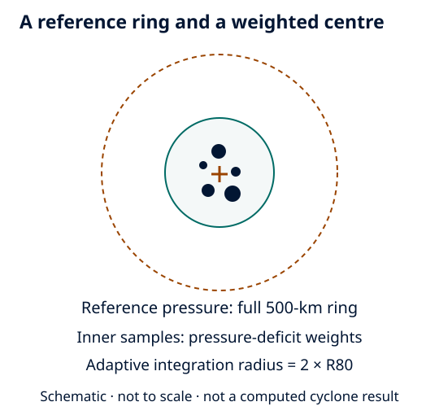

Adaptive pressure centroid
==========================

Select ``region.tracker.method: pressure_centroid`` to use the adaptive pressure-deficit
centroid of Nguyen, Molinari and Thomas (2014), DOI
``10.1175/MWR-D-14-00044.1``. The numerical choices and coupled motion solver
are specified below. This is an independent implementation, not a bitwise
reproduction of the authors' analysis code.

Use this method only with at least two increasing times and valid input coverage
of the full 500-km environmental-pressure ring. The extraction box does not limit
tracking reads. See `Configuration defaults`_ for controls and
`Inputs and supported grids`_ for the required fields.
For coupled runs, at least two times must remain in the tracker's actual centre
association; two atmospheric input times alone are insufficient.

   Method schematic, not a computed cyclone result. The environmental reference
   ring and adaptive integration region have different purposes and sizes.

Inputs and supported grids
--------------------------

The AROME preset requests MSLP, 10-m winds, and U, V and geopotential at all
available isobaric levels. At least two strictly increasing valid times are
required. The grid must be stationary, uniformly spaced latitude/longitude;
descending axes and longitude wrapping are supported. Winds must have
eastward/northward components (Earth-relative: U positive eastward, V positive
northward), with no storm velocity subtracted from the supplied winds; see
:ref:`wind-component-directions`. They are normalized to metres per second.
Pressure inputs normalize to Pa while exported ``environment_hpa`` remains hPa.

U and V are interpolated linearly in geopotential height to 2,000 m;
pressure is interpolated logarithmically. Geopotential is divided by
9.80665 m s-2. There is no vertical extrapolation. An exact endpoint uses
the endpoint value without requiring a finite zero-weight neighbour.

Meso-NH native-level inputs
--------------------------------------------------

``model: mesonh`` supports NetCDF native-level inputs on a stationary regional
structured grid, including projected grids with two-dimensional geographic
coordinates. The existing grid-spacing support limits still apply (see
:doc:`/user_guide/configuration_file`). Native ``ni``, ``nj`` and ``level``
coordinates and at least two increasing times are required.

The tracker needs these quantities even when they are not exported:

* Absolute model-level pressure: ``PABST`` preferred, otherwise ``PRES``.
  Declared pressure units are required and values are normalized to Pa.
* Model-level physical altitude: ``ALT`` in metres or another supported length
  unit. The adapter interprets native-level MNH ``ALT`` as positive-up altitude
  above mean sea level; contradictory AGL metadata is rejected.
* Horizontal winds: the complete ``UT_ZM``/``VT_ZM`` pair is preferred;
  otherwise the complete native ``UT``/``VT`` pair is used.
* Surface ``MSLP``, ``UM10`` and ``VM10``.

As a second explicit height representation, the adapter accepts the MNH
``level`` coordinate when it declares ``computed_standard_name: altitude``,
``formula_terms: s: level height: ZTOP orog: ZS`` (the referenced field names
may differ), and this exact ``formula_definition``:

.. code-block:: text

   z(n,k,j,i)=s(k)*(height-orog(j,i))/height+orog(j,i)

This evaluates ``z = s*(ZTOP-ZS)/ZTOP + ZS`` using declared length units.
Numeric ``level`` labels alone do not establish physical altitude. Other
coordinate formulas, including SLEVE, require explicit mass-level ``ALT``.
Valid mass-level ``ALT`` takes precedence over the formula. An ``ALT`` field
on the ``level_w`` interfaces is not a mass-level input; if supplied alone,
the tracker requires the complete declared ``level`` formula instead. It
never substitutes or interpolates interface altitude onto the mass grid.

Every selected file must contain a complete input set with consistent field
names, units, wind metadata and native coordinate labels. A missing field in
a later file is an error, even if another file supplies it. Candidate precedence
is recorded; the adapter does not mix pressure or wind sources between times.

Native winds are collocated linearly using the actual mass/staggered coordinate
pairs before height interpolation. Horizontal native coordinates normalize to
metres; missing coordinate units use the documented MNH metre input contract
and the affected coordinate names are recorded in track metadata.
Declare each selected model-level and surface pair with source ``wind_pairs``.
The basis must agree with source metadata. Grid-aligned pairs require an
explicit rotation method; see :ref:`wind-grid-contract` and
:ref:`wind-preparation-method` for equations and geometry checks. The tracker
records source frames and rotation. User fields use the same preparation contract.

Declared one-based inclusive ``c_grid_dynamic_range`` excludes nonphysical levels;
no first level is discarded when the file already contains only physical levels.
Pressure and winds are interpolated to **2,000 m altitude above mean sea level**,
using linear wind and log-pressure interpolation. Finite height columns must
be strictly monotone. Missing heights invalidate the column; nonpositive
absolute pressure is an error. Missing brackets remain missing: no vertical
extrapolation or substitution of sea-level pressure is performed. Required
reference-ring/R80/integration samples must remain valid.

MNH geometric altitude and AROME geopotential height are distinct definitions,
recorded in track metadata; numerical equivalence is not assumed.

Preparing Meso-NH diagnostics
~~~~~~~~~~~~~~~~~~~~~~~~~~~~~~~~~~~~~~~~~~~~~~~~~~

The following settings are documented for `MNH 6.0 NAM_DIAG
<https://mesonh.readthedocs.io/en/mnh-6-0/documentation/users_guide/executables_namelists/namelists/nam_diag_general.html>`_.
Merge the necessary settings into ``&NAM_DIAG`` in ``DIAG1.nam`` and run MNH's
``DIAG`` executable on the appropriate synchronous backups:

.. code-block:: fortran

   &NAM_DIAG
     LTPZH    = .TRUE.,
     LVAR_RS  = .TRUE.,
     LWIND_ZM = .TRUE.,
     LMSLP    = .TRUE.
   /

``LTPZH`` writes ``ALT`` and ``PRES`` among other diagnostics;
``LVAR_RS`` with ``LWIND_ZM`` writes ``UT_ZM`` and ``VT_ZM``;
``LMSLP`` writes ``MSLP``. Pressure-containing ``CISO`` selections such as
``'PR'`` also write ``PABST``; this is optional when ``PRES`` is available.
Keep native levels bracketing 2,000 m and a domain covering the entire 500-km
reference ring around every centre. Cropping the extraction box in FrameIt
does not reduce the tracker's input coverage requirement.

``UM10``/``VM10`` availability depends on the surface setup: the `MNH 6.0 DIAG
defaults <https://mesonh.readthedocs.io/en/mnh-6-0/documentation/users_guide/executables_namelists/namelists/nam_diag_default.html>`_
document them for ``CSURF='EXTE'``. Use the surface-diagnostic instructions for
your MNH/SURFEX version when they are absent. Do not change the simulated surface
physics just to satisfy the tracker. These recipes are version-specific; other
MNH versions need their corresponding documentation.

Missing-input errors list the missing quantities, affected file/times and the
MNH preparation settings above. Check regenerated inputs with:

.. code-block:: bash

   frameit init mesonh --tracking pressure_centroid --output mnh.yaml
   frameit validate mnh.yaml
   frameit config show mnh.yaml --effective

Edit the generated paths before validation. A complete example is
``example/config_file/conf_pressure_centroid_mnh.yml``.

Method
------

Initial guesses follow sequential 100-km MSLP search windows and 50-km
wind-minimum refinement windows, converted to index half-widths using the
resolved native grid spacing. The 2-km pressure minimum is searched within
100 km in index space around each MSLP minimum.

Each evaluation first converges a 100-km pressure-deficit centroid. Environmental
pressure is the bilinearly sampled mean over 180 bearings on a 500-km WGS84
ring. AROME native-cell weights are positive pressure deficits multiplied by
cos(latitude). MNH uses positive pressure deficits multiplied by nodal areas:
each native quadrilateral distributes one quarter of its WGS84 polygon area
to each mass-point vertex. This is a nodal quadrature, not a conservative
regridding claim. MNH horizontal sampling inverts the bilinear mapping within
native quadrilaterals in unwrapped geographic coordinates; cell connectivity is
retained and extrapolation is disabled. Cell edges are represented as straight
segments in those coordinates, an approximation to the native map projection.
Folded, concave or degenerate cells are rejected. Regional grids must span less
than 180 degrees longitude and exclude the poles. Integration and centre updates
use exact WGS84 geodesics.
The inner solver allows 40 steps with a 100-m tolerance, requires 16 finite
cells, and rejects steps exceeding 200 km.

The adaptive integration radius is twice the innermost rising crossing of
80 percent of the maximum azimuthal-mean cyclonic tangential wind. Winds
are storm-motion-relative and use the terminal-forward geodesic basis.
Motion uses central time differences and one-sided endpoint differences.
The outer solver couples motion and centres across the entire time sequence.
Convergence always uses the full, unrelaxed displacement residual.

Configuration defaults
----------------------

.. code-block:: yaml

   region:
     tracker:
       method: pressure_centroid
       convergence: {max_iterations: 15, tolerance_m: 250}
       motion:
         max_iterations: 50
         solver: aitken
         relaxation: 0.25
         tolerance_m: 250
       sampling:
         r80_max_distance_km: 250
         radial_step_km: 2.5
         azimuth_step_deg: 5

``fixed`` selects fixed geodesic relaxation. ``aitken`` starts with a full
update, clamps estimated relaxation to 0.15–1.5, guards residual growth,
temporarily falls back to fixed relaxation when stalled, and backtracks up
to three times after invalid accelerated evaluations.

A complete run configuration is provided in
``example/config_file/conf_pressure_centroid.yml``. Set its input and output
directories and run ``frameit run example/config_file/conf_pressure_centroid.yml``.

Missing reference-ring or R80 samples, unresolved R80 crossings, insufficient
finite integration cells, absent pressure deficits and nonconvergence raise
explicit errors. There is no local-reference or fixed-radius fallback.

Outputs
-------

The track NetCDF preserves continuous ``longitude`` and ``latitude``. Integer ``cx`` and
``cy`` identify the nearest WGS84 native grid cell for Cartesian extraction;
``grid_center_offset_m`` records the resulting offset. Kinematics and polar
origins use continuous centres. Diagnostics include ``r80_km``, ``radius_km``,
``environment_hpa``, ``iterations``, ``motion_residual_m``,
``motion_outer_iterations``, ``translation_u`` and ``translation_v``. Solver
translation uses central differences; the generic exported ``speed`` uses
forward differences. Global attributes record the implementation and settings.
MNH attributes record pressure/height/wind sources, height reference, vector frames
and rotation, quadrilateral interpolation and nodal area weighting under method
``frameit_mnh_native_v1``. Resolved inputs also appear in ``run-provenance.yaml``.

Troubleshooting reference-ring coverage
----------------------------------------

If the reference-ring check fails, inspect the reported candidate centre and
invalid sample count. The full ring needs finite pressure and horizontal stencils
at 2,000 m geopotential height (AROME) or altitude ASL (MNH). A partial ring is
not averaged.

Check the intended disturbance, input boundary, vertical brackets and masks.
Supply wider valid inputs or choose a suitable alternative tracker.
Increasing ``region.width_km`` changes only the output box; it cannot repair input
coverage. The reference radius is fixed by the method. A single snapshot cannot
support the motion-coupled track.

Dedicated verification
----------------------

Synthetic vortex, interpolation, solver and sub-grid integration checks establish
bounded numerical behavior. Scientific comparisons still need full-domain inputs
covering the 500-km ring; a small cropped example is insufficient.

MNH method record and qualification status
~~~~~~~~~~~~~~~~~~~~~~~~~~~~~~~~~~~~~~~~~~~~~~~~~~

* **Quantity/maturity:** implemented MNH input/grid extension to the existing
  adaptive pressure centroid; independently checked on synthetic fields.
  Full-domain real-MNH qualification and independent scientific review remain
  outstanding. Passing the tests is not a claim of validity for all MNH cases.
* **Scientific reference:** Nguyen, Molinari and Thomas (2014), cited above.
  The MNH extension adds no new stable-method or community-adoption claim.
* **Inputs/conventions:** the quantities, units, mass-grid preparation, height
  reference and candidate precedence are specified above. At least two times
  support the existing storm-motion-coupled solve.
* **Numerical departures:** native absolute-pressure columns and geometric
  altitude replace isobaric/geopotential inputs; geographic quadrilateral
  interpolation and WGS84 nodal areas replace the latitude–longitude sampler
  and latitude-only weights. Solver constants and convergence controls are
  unchanged. Geometry is reused and only 2-D prepared fields are retained across
  times; 3-D inputs are evaluated one timestamp at a time. No ESMF backend is
  required for this tracker.
* **Independent cases/tolerances:** exponential pressure columns and affine
  winds verify exact log/linear interpolation (pressure relative tolerance
  1e-14); analytic bilinear fields verify inverse cell mapping; summed geodesic
  polygon areas verify nodal weights; a stationary and translating analytic
  vortex on a 10-km projected grid must recover centres within 1 km (one tenth
  of the source spacing) and meet the existing 250-m solver residual. These
  synthetic bounds are not operational accuracy estimates.
* **Failure/applicability:** missing inputs, incompatible layouts/units,
  unresolved physical heights, invalid vector frames, unsupported geometry,
  missing required sampling support and nonconvergence fail explicitly.
  No pressure, height, time or reference-radius fallback is introduced.
* **Provenance/review gaps:** source choices and transformations are recorded
  as described above. Real DIAG layouts, mountainous masks, projection
  sensitivity and full-domain scientific comparisons require further
  representative-data qualification; no human scientific sign-off is implied.

Known limitations
------------------

* Complete reference-ring, R80 and integration support is required; no partial-ring,
  local-pressure, fixed-radius, vertical-extrapolation or MSLP fallback is used.
* At least two increasing times are needed. Unresolved R80, insufficient deficits
  and nonconvergence fail explicitly.
* Continuous centres define polar origins; native Cartesian crops remain grid-aligned.
* Synthetic checks do not establish real-MNH accuracy, mountainous-mask robustness
  or independent scientific acceptance.
