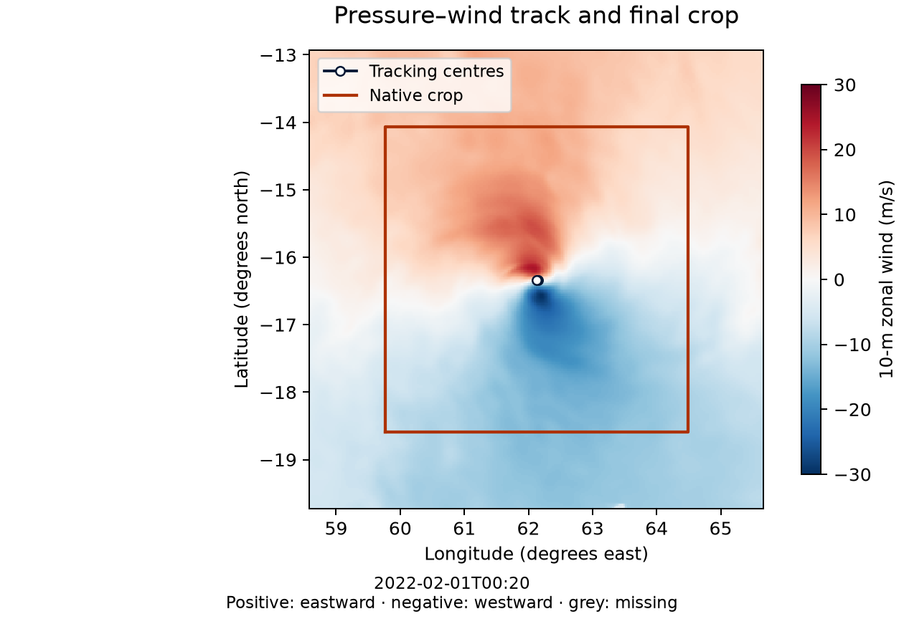

Pressure-wind tracker
=====================

For setup and run checks, use :doc:`../task_guides/moving_region`.

Overview
--------

The pressure-wind tracker (``tracking.method: pressure_wind``) estimates the cyclone center at each time step using a sequential two-stage procedure combining:

1. a *pressure-based first guess* from mean sea-level pressure (MSLP),
2. a *wind-based refinement* using the 10 m wind speed magnitude.

The output contains native centre indices ``cy(time)`` and ``cx(time)``.

Required input fields
---------------------

This tracker requires the following variables to be available in the dataset:

- Mean sea-level pressure (MSLP),
- 10 m zonal wind component,
- 10 m meridional wind component.

Algorithm
---------

Notation
~~~~~~~~

Let:

- ``mslp(t, y, x)`` be the MSLP field at time index ``t``,
- ``u10(t, y, x)``, ``v10(t, y, x)`` be the 10 m wind components,
- ``W(t, y, x) = sqrt(u10^2 + v10^2)`` be the 10 m wind speed magnitude,
- ``(cy_t, cx_t)`` be the cyclone center indices at time ``t``,
- ``half_search`` be the half-width of the MSLP search window,
- ``half_refine`` be the half-width of the wind refinement window.

Sequential procedure
~~~~~~~~~~~~~~~~~~~~

Initialization (t = 0)
^^^^^^^^^^^^^^^^^^^^^^

1. **MSLP first guess**:
   compute the global minimum of MSLP at ``t = 0``, yielding a first-guess index pair
   ``(cy_fg, cx_fg)``.

2. **Wind refinement**:
   build a sub-window centered on the first guess with half-width ``half_refine`` and
   select the minimum of wind speed magnitude ``W`` inside that window.

   - If the refinement sub-window contains only missing values, the wind minimum is
     computed over the full domain.

3. Store the resulting indices as ``(cy_0, cx_0)``.

Tracking for t >= 1
^^^^^^^^^^^^^^^^^^^

For each time step ``t = 1..nt-1``:

1. **Restricted MSLP search around previous center**:
   define a search window centered on ``(cy_{t-1}, cx_{t-1})`` with half-width
   ``half_search`` and compute the minimum of MSLP in that window.

   - If this MSLP sub-window contains only missing values, the MSLP minimum is computed
     over the full domain.

   The corresponding minimum defines the pressure-based first guess ``(cy_fg, cx_fg)``.

2. **Wind refinement around the MSLP first guess**:
   define a refinement window centered on ``(cy_fg, cx_fg)`` with half-width
   ``half_refine`` and compute the minimum of wind speed magnitude ``W`` in that window.

   - If the wind sub-window contains only missing values, the wind minimum is computed
     over the full domain.

3. Store the refined indices as ``(cy_t, cx_t)`` and proceed to the next time step.

Window sizes and conversion from physical half-widths
--------------------------------------------------------

The tracker uses two configurable square half-widths (in kilometres):

- ``tracking.pressure_wind.search_half_width_km = 100``: MSLP search,
- ``tracking.pressure_wind.refine_half_width_km = 50``: wind refinement.

These windows are converted into grid-point half-widths using resolved native
grid geometry. Grid spacing is inferred before tracker construction.

Given the resolved grid spacing ``grid_spacing_m`` in metres,
the tracker computes:

- ``grid_spacing_km = grid_spacing_m / 1000``,
- ``half_search = ceil(search_half_width_km / grid_spacing_km)``,
- ``half_refine = ceil(refine_half_width_km / grid_spacing_km)``,

and enforces a minimum value of 1 grid point for both.

Configuration and usage
-----------------------

To activate this tracker in the YAML configuration, set:

.. code-block:: yaml

   tracking:
     method: pressure_wind
     pressure_wind:
       search_half_width_km: 100
       refine_half_width_km: 50

Illustration
------------

Pressure-wind tracking on the two BATSIRAI times, with
``domain.width_km: {x: 500, y: 500}`` (full widths in kilometres).
The outline shows the final native crop. The two centres are only one native
grid point apart; no artificial displacement or second centre marker is added.

   Actual tracking output over stored 10-m zonal wind at 00:20, not independent
   evidence of track accuracy. The :doc:`external plotting recipe
   <../reference/illustrations>` declares the source, time and wind convention.

Optional initial position
-------------------------

Restrict the first MSLP search to a user-selected position and radius:

.. code-block:: yaml

   tracking:
     source: atmosphere  # For coupled atmosphere/SURFEX inputs
     method: pressure_wind
     pressure_wind:
       initial_guess:
         latitude: -5.8
         longitude: 50.0
         search_radius_km: 100
       search_half_width_km: 100
       refine_half_width_km: 50

Adapt these coordinates to the intended disturbance. The seed applies to the
first selected input timestamp; it does not filter input times.
Latitude/longitude are degrees north/east in [-90, 90]/[-180, 180], and the
radius must be finite and positive. Distances use the WGS84 geodesic and include
grid points at the radius. The method searches finite MSLP candidates within
the circle on the available grid; it does not require complete circular coverage.
No valid candidate causes an error, never a global-search fallback at initialization.
Wind refinement may move the centre outside this circle. Later times use the
search and fallback policy described above.

Omit ``initial_guess`` (or set it to ``null``) to retain the global initial MSLP
search. The effective configuration and seeded track attributes record the
position, radius and search convention. Check the first centre against the
intended disturbance.

Known limitations
------------------

* **Minima are not unique cyclone identifiers:** another low-pressure system or
  weak-wind area can be selected. Disorganised or asymmetric systems need manual
  inspection; the pressure minimum and wind-refined centre need not coincide.
* **Initial selection:** without ``initial_guess``, the first pressure search is
  global. A seed restricts pressure candidates, not the following wind refinement.
* **Search windows:** large movement between saved times or poorly chosen window
  widths can lose the intended disturbance. Windows are square native-index
  searches, not exact geodesic disks.
* **Missing-data fallbacks:** an all-missing local window triggers the documented
  full-domain search. This can jump to another disturbance; inspect the trajectory.
* **Grid-point centres:** positions and Cartesian crops are quantized to native
  points. This method does not diagnose a continuous sub-grid centre or provide
  calibrated position uncertainty.
