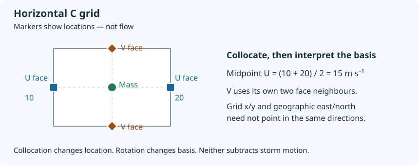
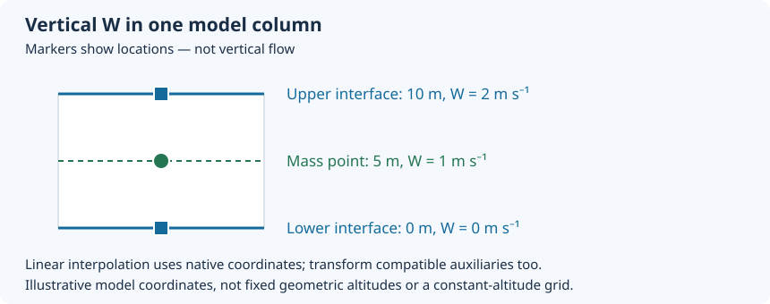

Output files
============

FrameIt produces NetCDF output files that are designed to be shareable and easy to reuse with standard tools
(xarray, NCO, CDO, ncview).

The output files are :

- cyclone track dataset
- user-requested variables extracted on a cartesian box
- user-requested variables extracted on a polar grid (optional)

Naming convention
-----------------

All files use ``run.name`` as a prefix (see :doc:`configuration_file`), referred to below as ``SIMU``.

Track file:

- ``SIMU.track.nc``

Group files (one file per group key in the output dictionaries):

- ``SIMU.cart.<group>.nc``  (cartesian crop products)
- ``SIMU.polar.<group>.nc`` (polar projection products)

The ``<group>`` token is the corresponding key of the dictionary (for example ``surface``, ``level``,
``heightAboveGround``). The name is sanitized for filenames (any non-alphanumeric character is replaced by ``_``),
but the original group name is preserved in the file metadata (see below).

``output.directory`` is the run root (see :doc:`configuration_file`).
Artifacts use the same layout for ordinary runs and each matrix case::

    <output_dir>/
        cache/       # GRIB index files
        products/    # Track, Cartesian and polar NetCDF files
        logs/        # Simulation logs
        resolved-config.yaml  # Reloadable effective schema-v2 configuration
        run-provenance.yaml   # Geometry, inputs, units, and execution settings

GRIB indexes are stored in ``cache/``, never beside the input files. Cache
filenames distinguish input paths and cfgrib indexing keys. Meso-NH NetCDF
loading does not create disk indexes; its processing caches remain in memory.
Migration removes the ineffective legacy ``grib_index_dir`` YAML field;
indexes always use the run's ``cache/`` directory.

Previously, ordinary runs wrote products and logs directly into the run root.
Existing files are not moved; new runs use the layout above.

Produced files
--------------

SIMU.track.nc
~~~~~~~~~~~~~

This file contains the cyclone trajectory and kinematic diagnostics computed by the tracking module and typically includes:

- Coordinates: ``time``
- Data variables: center indices (for example ``cx``, ``cy``), latitude and longitude, motion estimates
  (for example ``heading_deg``, ``speed``), and any additional diagnostic variables created by
  ``enrich_track_with_kinematics``.

This file is intended to be the minimal entry point to interpret all other FrameIt products.

SIMU.cart.<group>.nc
~~~~~~~~~~~~~~~~~~~~

These files contain user-requested fields extracted on a cartesian box around the storm center or the fixed subdomain center.

Typical structure:

- Dimensions: ``time``, plus spatial axes such as ``x_box`` and ``y_box``
- Optional vertical dimension depending on the group (``level`` or ``heightAboveGround``)
- Coordinates commonly include: ``latitude``, ``longitude``, and box metrics ( ``x_box_km``,
  ``y_box_km``) when available
- Data variables depend on the YAML request (see :doc:`configuration_file`)

If you export cartesian crops, you obtain one file per vertical group, which keeps the outputs modular
and avoids mixing incompatible vertical coordinates in a single file.

.. _wind-grid-contract:

Wind locations, reference frames and output choices
~~~~~~~~~~~~~~~~~~~~~~~~~~~~~~~~~~~~~~~~~~~~~~~~~~~

.. note::

   Defaults are Cartesian horizontal ``mass_earth``, Cartesian vertical
   ``interfaces`` and polar vertical ``mass``. Generated templates show these
   choices explicitly. Numerical conventions and qualification limits are in
   :ref:`wind-preparation-method`; source references do not establish scientific
   validation for every input grid.

**Location is not direction.** On a Meso-NH C grid, U and V are sampled on
different horizontal faces; scalars occupy mass points. Grid-relative components
follow the model axes; Earth-relative components point east and north.
Collocation changes sampling locations; rotation changes the vector basis.
Neither operation subtracts storm motion.

   Original schematic. Symbols mark sample locations, not flow arrows.
   For a midpoint, U at the two faces (10 and 20 m s-1) gives mass-point
   U = 15 m s-1. V is collocated along its own staggered axis.

Choose Cartesian horizontal representation independently of vertical W:

.. list-table:: Native versus mass-point products
   :header-rows: 1
   :widths: 22 39 39

   * - Choice
     - Benefit
     - Trade-off
   * - ``horizontal_winds: native``
     - Preserves source staggering and declared vector basis; useful for
       model-grid calculations. Velocity units are still normalized.
     - U/V need their own coordinates; collocate and, when needed, rotate
       before geographic vector analysis.
   * - ``horizontal_winds: mass_earth`` (default)
     - Collocated east/north components suit comparison and ordinary plotting.
     - Interpolation can smooth gradients; original face samples are not retained.
   * - ``vertical_velocity: interfaces``
     - Retains W at native vertical interfaces (Cartesian default).
     - W does not share mass-level locations with scalar fields.
   * - ``vertical_velocity: mass``
     - W shares mass-level locations (polar default).
     - Requires bracketing interfaces and interpolation; not native W samples.

Cartesian ``native`` output preserves source sample locations, staggering and
declared basis, with normalized velocity units. A requested box uses distinct
``(y_u_box, x_u_box)`` and ``(y_v_box, x_v_box)`` axes for U and V. Along a
staggered direction, N mass cells have N+1 bounding faces; unavailable faces are
NaN. Source coordinates, including face geolocation, remain auxiliary coordinates
on these box axes. Full-domain native output without a crop retains original
dimensions. Read each field's coordinates rather than assuming literal source
dimension names survive a crop.

Tracking and polar processing use a separate mass-point, Earth-relative analysis
representation: changing the Cartesian output switch does not change the track
or polar result. NetCDF inputs normalize units per file before concatenation;
tracker and user-field preparation share the declared frame/rotation contract.

Requested ``wind_speed`` uses collocated mass-point horizontal components,
:math:`\sqrt{u_m^2+v_m^2}`, even beside native Cartesian U/V. Taking ``hypot`` of
U and V face arrays combines different locations and is not a point wind speed.
Polar horizontal winds are always collocated, Earth-relative samples on
``(rr, theta)``; speed is computed from the interpolated components, not by
interpolating native scalar speed. A speed-only request loads the declared pair
internally without exporting internal-only components. For polar products,
retaining native staggering applies only to **vertical W interfaces**, never to
horizontal U/V faces or their basis.

Vertical W and level selection
''''''''''''''''''''''''''''''

   Original one-column example: lower W = 0 m s-1 at coordinate 0 m,
   upper W = 2 m s-1 at 10 m, giving mass W = 1 m s-1 at 5 m.
   These are illustrative model-coordinate values, not a constant-altitude grid.

Interpolate using actual native coordinate positions, before sparse selection
removes neighbours. Coordinates and compatible auxiliaries must describe the
new sampling locations too: changing only the W dimension label is insufficient.
Terrain-following mass/interface coordinates do not imply fixed geometric
altitudes; this operation is not interpolation onto constant-altitude surfaces.
W and its internal mass-point carrier are handled field by field. Choosing mass
W moves W to the mass-level group, removes its internal carrier from exports,
and does not move or discard other interface variables or their coordinates.

Level selection follows these rules:

* ``levels: all`` and ``levels: stored`` retain the original stored levels,
  including stored extra levels; neither means physical-domain trimming.
* ``levels: physical`` uses adapter-validated physical mass and interface ranges,
  separately. Missing or ambiguous ranges fail; no universal first/last-level
  trimming is assumed.
* ``levels: {indices: [...]}`` uses zero-based **original stored indexing**,
  not indexing renumbered after physical-range selection. Value selections use
  the native coordinate and its units.
* If mass-level fields are explicitly selected, their selected mass levels set
  the W-to-mass targets. Otherwise, physical W selection targets the validated
  physical mass levels, not the physical interface range. For legacy sparse
  interface-index requests, interface index ``k`` maps to the same native mass
  index ``k``; the source-interface/target-mass mapping is reported.
  This compatibility map is not an assertion that their coordinates coincide.

AROME ``w`` is pressure vertical velocity :math:`\omega=Dp/Dt` in Pa s-1;
``wz`` is geometric vertical velocity in m s-1. They remain distinct quantities.
There is no implicit hydrostatic conversion or substitution between them, and
the Meso-NH W staggering choices do not turn omega into geometric velocity.
See :doc:`input_files` for authoritative model/GRIB definitions and
:doc:`configuration_file` for explicit pair and rotation declarations.

SIMU.polar.<group>.nc
~~~~~~~~~~~~~~~~~~~~~

These files contain the polar-projected products. 
They are typically created after the cartesian extraction, using the polar projection module.

Typical structure:

- Dimensions: ``time``, radial coordinate (``rr``), angular coordinate (``theta``),
  plus optional vertical dimension depending on the group
- Coordinates may include:
  - Polar grid axes: ``rr`` (km) and ``theta`` (radians), with ``theta_deg`` in degrees
  - Derived cartesian coordinates on the polar grid: ``x_km`` and ``y_km``
  - Geolocation: ``lat(time, rr, theta)``, ``lon(time, rr, theta)``
- Data variables depend on the requested fields (see :doc:`configuration_file`).

The polar files also include a set of attributes that document the angular convention (for example the
zero-angle location and rotation direction) as produced by the polar projection module.

Metadata and attributes
-----------------------

FrameIt adds a minimal set of global attributes to each file:

- ``Conventions`` (currently ``CF-1.8``)
- ``title``, ``summary``, ``institution``, ``source``
- ``simulation_id`` (from ``run.name``)
- ``FRAMEIT_version`` (from the installed FrameIt package)

Additional export-specific attributes:

- ``product_type``: one of ``track``, ``cart``, ``polar``
- ``group``: the original dictionary key (for group files)
- ``track_filename``: the corresponding track file name (for group files)

A ``history`` attribute is appended at write time and includes a UTC timestamp and the exporting module.

Attribute sanitization
~~~~~~~~~~~~~~~~~~~~~~

NetCDF backends do not accept complex Python objects as attributes. During export:

- Python dictionaries, lists, or tuples found in ``ds.attrs`` are converted to JSON strings and stored under
  a ``*_json`` attribute name.
- Boolean attributes are converted to integer flags (0 or 1), because the netCDF4 backend does not support
  boolean attributes.

Compression and performance
---------------------------

By default, the exporter applies DEFLATE compression to all data variables:

- ``zlib=True``, ``shuffle=True``, ``complevel=<compress_level>``

Notes:

- Lower compression levels (for example 1) typically write faster but generate larger files.
- Higher compression levels reduce size but increase CPU cost during export.
- Export time is also controlled by dask materialization, because writing triggers computation of lazy arrays.

Coordinates are not compressed by default. Configure storage with
``output.compression: {level: 2, coordinates: false}``. The default level is 1;
storage chunks are backend-selected. Compression does not change wind sampling
or vector definitions.

NetCDF exports
--------------

By default, the CLI runs NetCDF exports at the end of the pipeline:

- NetCDF export: enabled by default
- Polar export: enabled by default
- Cartesian export: enabled by default

Writing requires an available product; polar computation is enabled separately
with ``polar.enabled``. Set exports explicitly in YAML, for example:

.. code-block:: yaml

   output:
     export: {netcdf: true, cartesian: true, polar: false}

Set ``netcdf: false`` to disable all NetCDF writing, or ``cartesian: false`` to
omit Cartesian products. See :doc:`configuration_file` for precedence.
