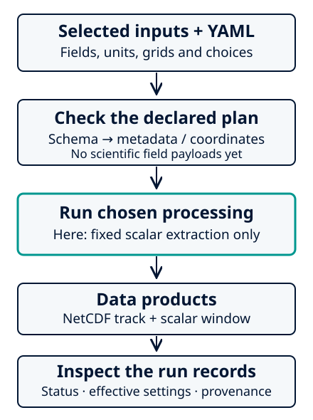
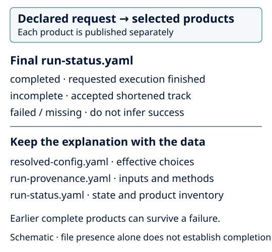
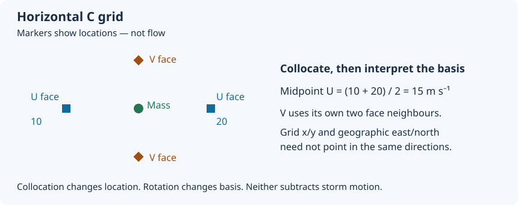
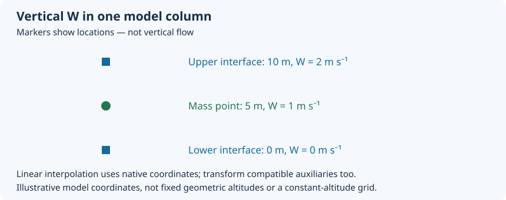

Output files
============

FrameIt writes NetCDF products that can be opened without FrameIt, for example
with xarray/netCDF4, NCO or CDO. Alternatively, ``output.backend: zarr`` selects
sharded Zarr v3 directory stores, readable with compatible xarray/Zarr readers
(not the NetCDF readers NCO/CDO). Existing scripts still need compatible variable
definitions, dimensions, coordinates and reader support; a matching format alone
does not make schemas or physical quantities equivalent.

The products are a track dataset, selected variables on Cartesian subdomains,
and optionally selected polar samples. Review ``run-status.yaml`` and provenance
before interpreting them, including tracking completeness, time exclusions and
scaling/missing-data observations. A completed run is not scientific approval.

   Schematic. Select processing in the configuration; retain products and their
   effective settings, provenance and completion record together.

Naming convention
-----------------

All files use ``run.name`` as a prefix (see :doc:`configuration_file`), referred to below as ``SIMU``.

Track file:

- ``SIMU.track.nc``

Group files (one file per group key in the output dictionaries):

- ``SIMU.cart.<group>.nc``  (cartesian crop products)
- ``SIMU.polar.<group>.nc`` (polar projection products)

The ``<group>`` token is the corresponding key of the dictionary (for example ``surface``, ``level``,
``heightAboveGround``). Filename tokens retain ASCII letters/digits, ``.``, ``_``
and ``-``; other characters become ``_``. The original group name is preserved
in file metadata.

``output.directory`` is the run root (see :doc:`configuration_file`).
Artifacts use the same layout for ordinary runs and each matrix case::

    <output_dir>/
        cache/       # GRIB index files
        products/    # Track, Cartesian and polar .nc files or .zarr stores
        logs/        # Simulation logs
        resolved-config.yaml  # Reloadable effective schema-v2.1 configuration
        run-provenance.yaml   # Geometry, inputs, units, and execution settings
        run-status.yaml       # Completion state, runtime/resources, product inventory
        .frameit-run.lock     # Present while an attempt owns this root

Coupled and native FA products
------------------------------

Coupled sources use this layout with source-qualified groups, for example
``SIMU.cart.surfex.surface.nc``. The shared track records per-source indices;
Cartesian grids are not implicitly regridded. Exact-time exclusions and native
FA diagnostics are reported in provenance/final status. See :doc:`fa_inputs`.
FA variables additionally carry a JSON ``fa_field_descriptor`` input snapshot
and ``fa_field_descriptor_scope``. This is a representative input-record
description, not a combined multi-time or post-crop description. Per-file
descriptors and post-decode scaling/mask facts are retained in run provenance
and decoder logs; see :doc:`FA metadata and provenance <fa_contracts>`.
Spectral FA coefficients have no admitted output contract and cannot be returned
as gridpoint values; see :doc:`Spectral support and limitations <fa_spectral>`.
Explicit native atmospheric cubes use separate ``level``/``level_w`` axes,
original record IDs and source-native indices, plus pressure-valued/normalized
interface coefficients and the source reference pressure. Native indices are
not pressure or height coordinates; the complete coefficient axis survives
sparse data selection without re-expanding unselected levels. See
:doc:`Native atmospheric levels and cubes <fa_atmosphere>`.

Decoder observations identify actual helper/backend versions, returned native
masks and post-normalization full-native nonfinite counts. A count before
cropping is not the output mask. Support labels, native undefined/IEEE NaN
samples, extension zones and valid physical zeroes remain separate facts.
Missing values are not converted to physical zeroes to complete an output.

``sources.<id>.fa_decoder.payload_reads`` identifies actual read calls by source
basename and native field. Decoder JSONL logs retain individual requests and
scaling observations; see :doc:`fa_contracts` for descriptor meanings and limits.

Projected FA tracking adds selected-grid latitude/longitude and source-CRS
snapping offsets to the track, source-prefixed in coupled products. Continuous
``lat``/``lon`` remain requested centres; see
:doc:`FA geometry and centres <fa_geometry>` for conventions.
With ``polar.shared_target: true``, separate source-qualified polar products share
a verified target ID and exactly matching time/radius/azimuth/lat/lon coordinates.
Source masks and variable meanings remain independent. Vertical-group separation
is retained. See :doc:`Coupled atmosphere/surface sampling <fa_surface>` for target
settings and :doc:`ocean_netcdf` for ocean-specific conventions.

Completion, provenance and ordinary readers
-------------------------------------------

GRIB indexes are stored in ``cache/``, never beside the input files. Cache
filenames distinguish input paths and cfgrib indexing keys. Meso-NH NetCDF
loading does not create disk indexes; its processing caches remain in memory.
Normal execution atomically publishes each complete NetCDF/YAML file through a
same-directory temporary file. Interrupted attempts can retain complete earlier
products or hidden ``*.partial`` files. The authoritative completion record is
``run-status.yaml`` (schema version 1), written last after export and input cleanup.
It lists relative product paths, byte sizes, tracking completeness, execution
limits, package/native-backend versions and selected Slurm metadata. Scientific
provenance also records versions and code revision/dirty state when available.
Sizes and paths are not content checksums. ``completed`` means the requested
execution finished; a permitted shortened track is marked ``incomplete``.
With ``execution.require_complete_tracking: true``, an incomplete track fails
before export. Missing final status, a failed state or an abnormal process exit
must not be inferred successful from the presence of one file. Atomic publication
is per product, not an all-products transaction or an fsync durability guarantee.
See :doc:`/getting_started/hpc` for states, ownership and retry policy.

``metadata.extra`` is serialized as the JSON global attribute
``frameit_user_metadata_json`` for ordinary readers of either output backend.

   Schematic. Final status describes execution; provenance describes how the
   data were produced. Neither replaces scientific inspection of the result.

For a run using the default AROME template, an ordinary-reader inspection is:

.. code-block:: python

   import xarray as xr

   with xr.open_dataset("output/products/arome-pressure-wind.cart.surface.nc", engine="netcdf4") as ds:
       print(ds.sizes)
       print(ds.coords)
       print(ds["u10"].attrs)
       print(ds["u10"].dtype, ds["u10"].encoding)

Use the actual paths and selected variables in ``run-status.yaml``; coupled runs
have source-qualified groups. Check each variable's coordinates, units, basis,
missing-value metadata and storage dtype rather than assuming that similarly
named variables share definitions. xarray normally decodes CF time and missing
values; a valid zero remains data. Source valid times, forecast reference cycles
and accumulation/averaging intervals are distinct and must not be conflated.
FA temporal declarations are instantaneous only; no interval conversion is
inferred to complete a product. JSON attributes such as ``fa_field_descriptor``
can be read with ``json.loads`` from Python's standard library.

For the self-contained :doc:`first run <../getting_started/first_run>`, the
ordinary-reader check is:

.. code-block:: python

   import numpy as np
   import xarray as xr

   with xr.open_dataset("results/products/first-run.cart.surface.nc",
                        engine="netcdf4") as ds:
       q = ds["instructional_scalar"].transpose("time", "y_box", "x_box")
       assert dict(ds.sizes) == {"time": 2, "y_box": 5, "x_box": 5}
       assert q.attrs["units"] == "1"
       assert q.values[0, 2, 2] == 0
       assert np.isnan(q.values[0, 1, 3])
       print(ds.time.values, ds.latitude.attrs, ds.longitude.attrs)

Use :doc:`../concepts/missingness_and_status` to distinguish missing support from
zero, and :doc:`../concepts/time_support` when labels and averaging intervals differ.
For NEMO ``preceding_hour`` association, inspect ``source_time`` and unchanged
bounds as well as coupling ``time``. Native ocean depth and CROCO sigma groups
retain their own axes/dependencies; polar sigma samples are not constant-depth
sections. See :doc:`ocean_netcdf` before reconstructing or comparing depth fields.

.. _sharded-zarr-output:

Sharded Zarr v3
---------------

Select ``output.backend: zarr`` after installing the optional ``zarr`` extra
(Python 3.13, xarray >= 2026.9.0, Zarr-Python >= 3.4.2 and < 4). NetCDF remains
the default. The same track, Cartesian groups and requested polar groups are
written as local directory stores: ``SIMU.track.zarr``,
``SIMU.cart.<group>.zarr`` and ``SIMU.polar.<group>.zarr``. Source-qualified
groups keep the same naming rules. Only the selected backend is written.

Variables, dimensions, coordinates, physical units, missing samples and
scientific metadata meanings are preserved. Decoded values are written without
additional quantization or source integer repacking. Compression is lossless
gzip at ``output.compression.level`` (default 1; 0 disables it); coordinates are
uncompressed unless ``output.compression.coordinates: true``. There is no
NetCDF-style unlimited dimension, append/resume or remote-store support.

Chunks versus shards
~~~~~~~~~~~~~~~~~~~~

A **chunk** is a small block of array values encoded and compressed independently.
A reader can decompress only the chunks needed for a selection rather than the
whole array. Smaller chunks can reduce unnecessary reading for small selections,
but too many tiny chunks add indexing, compression and scheduling overhead.

A **shard** packs several chunks into one stored object: one file in these local
stores. This reduces the number of files without making the whole shard the
unit of decompression. Compatible readers can retrieve individual chunks inside
a shard; actual disk I/O and caching depend on the reader. Larger shards reduce
file counts but can increase write memory and the amount of work per task.

Both sizes count **array elements along each named dimension**, not bytes or
numbers of files. For example::

    output:
      backend: zarr
      zarr_chunk_size: {time: 1, y_box: 128, x_box: 128}
      zarr_shard_size: {time: 8, y_box: 512, x_box: 512}

Each chunk holds one time and 128 by 128 grid points. Each full shard covers
eight times and 512 by 512 points: ``8 * 4 * 4 = 128`` chunks. Boundary shards
can be partially filled; arrays need not be divisible by these sizes. These
settings do **not** change scientific resolution, sampling, precision or values.

Defaults and tuning
~~~~~~~~~~~~~~~~~~~

Both mappings are optional; ``output.backend: zarr`` alone works. For each product:

* Time chunks contain one element; a time shard spans eight chunks.
* The last two non-time dimensions in dataset order use chunk extents of
  ``min(dimension length, 128)``, with four chunks per shard along each axis.
  These normally correspond to the two spatial axes. Other dimensions use
  chunk and shard extents of one, avoiding large vertical-cube write blocks.
* Explicit chunk sizes replace those defaults. Without a shard override,
  the default number of chunks per shard is retained.
* A shard-only override chooses a chunk extent equal to the greatest common
  divisor of the default chunk extent and requested shard extent. Supplying
  both settings avoids surprises and gives direct control.
* All sizes must be positive integers, not YAML booleans. Explicit shard
  extents must be multiples of explicit chunk extents. Configured dimensions
  absent from a product are ignored, so Cartesian settings do not break the
  track or polar stores. Check spelling against the actual output dimensions.
* Scalars such as a CRS variable are not sharded. Empty dimensions fail with
  an actionable error; this writer does not publish empty-axis products.

Use ``x_box``/``y_box`` for Cartesian products and ``rr``/``theta`` for polar
products, plus the actual vertical dimensions where needed. Configure both
sets in the mappings if the same run needs different layouts. The actual
layout is inspectable in each array's ``zarr.json`` metadata or through
``zarr.open_group(path)[variable].chunks`` and ``.shards``.

Storage chunks are not the input or polar-processing **Dask chunks**. Before
writing, FrameIt rechunks lazily to shard boundaries so parallel tasks do not
write different chunks into the same shard simultaneously. It does not load
the entire dataset eagerly. Write memory depends on shard size, dtype and
concurrency; explicitly requesting very large shards can still exhaust memory.
Zarr's internal concurrency is capped to one while writing, leaving parallelism
to the configured Dask/export workers. There is no universally optimal layout:
start with defaults and measure representative selections before tuning.

The :doc:`storage/resource guide <../task_guides/storage_and_resources>` includes
the chunks/shards schematic and a bounded pilot configuration.

Completion and reading
~~~~~~~~~~~~~~~~~~~~~~

FrameIt writes a private sibling temporary directory and publishes it after
the complete store has been written. Under the existing exclusive run-root
lock, a replacement first renames the previous store to a private backup;
caught publication errors restore that backup. Unlike NetCDF file replacement,
replacement of a nonempty directory has a brief visibility gap and is **not an
atomic directory exchange**. A killed process can leave hidden
``.frameit-*.partial`` or ``.frameit-*.backup`` directories. A backup may contain
the previous complete product; do not delete or restore it until the writer
has stopped. Unrelated directories and symlinks are not overwritten as stores.
This is not an fsync durability or all-products transaction guarantee.

``run-status.yaml`` remains the authoritative completion record. Its product
paths refer to store directories and ``size_bytes`` sums all stored files
recursively, not the directory inode size. Paths and sizes are not checksums.
Scientific provenance retains effective settings and the loaded Zarr version.

No FrameIt import is needed to read a completed product:

.. code-block:: python

   import xarray as xr

   with xr.open_zarr("output/products/arome-pressure-wind.cart.surface.zarr",
                     consolidated=False) as ds:
       print(ds.sizes, ds.coords)
       print(ds["u10"].attrs)

Stores use v3 dimension metadata and non-consolidated metadata. Readers must
support Zarr v3, its sharding codec and the stored dtypes. The writer dependency
versions above provide a tested reader combination.

Produced files
--------------

SIMU.track.nc
~~~~~~~~~~~~~

This file contains the fixed or moving geographical centres and track diagnostics:

- Coordinates: ``time``
- Data variables: center indices (for example ``cx``, ``cy``), latitude and longitude, motion estimates
  (for example ``heading_deg``, ``speed``), and any additional diagnostic variables created by
  ``enrich_track_with_kinematics``.

For a single-time automatic track, ``lat`` and ``lon`` still identify the centre
used by every coupled source. ``heading_deg``, ``dist`` and ``speed`` are NaN:
one position cannot establish motion, and missing motion is not physical zero.

SIMU.cart.<group>.nc
~~~~~~~~~~~~~~~~~~~~

These files contain selected fields on a native Cartesian crop around each
geographical centre. A Cartesian product is not automatically a common regridded
mesh across sources.

Typical structure:

- Dimensions: ``time``, plus spatial axes such as ``x_box`` and ``y_box``
- Optional vertical dimension depending on the group (``level`` or ``heightAboveGround``)
- Coordinates commonly include: ``latitude``, ``longitude``, and box metrics ( ``x_box_km``,
  ``y_box_km``) when available
- Data variables depend on the YAML request (see :doc:`configuration_file`)

Each vertical group has its own file.

.. _wind-grid-contract:

Wind locations, reference frames and output choices
~~~~~~~~~~~~~~~~~~~~~~~~~~~~~~~~~~~~~~~~~~~~~~~~~~~

.. note::

   Defaults are Cartesian horizontal ``earth_centered``, Cartesian vertical
   ``interfaces`` and polar vertical ``mass``. Numerical conventions and
   qualification limits are in :ref:`wind-preparation-method`.

**Location is not direction.** On a Meso-NH C grid, U and V are sampled on
different horizontal faces; scalars occupy mass points. **Grid-aligned components**
(grid-relative) follow the model's x/y axes. **Eastward/northward components**
(Earth-relative) have U positive toward geographic east and V toward geographic
north.
Collocation changes sampling locations; rotation changes the vector basis.
Neither operation subtracts storm motion: exported velocities remain relative
to the ground, not the moving storm. See :ref:`wind-component-directions`.

   Original schematic. Symbols mark sample locations, not flow arrows.
   For a midpoint, U at the two faces (10 and 20 m s-1) gives mass-point
   U = 15 m s-1. V is collocated along its own staggered axis.

Choose Cartesian horizontal representation independently of vertical W:

.. list-table:: Native versus mass-point products
   :header-rows: 1
   :widths: 22 39 39
   :class: config-table

   * - Choice
     - Benefit
     - Trade-off
   * - ``horizontal_vectors: native``
     - Preserves source staggering and declared vector basis; useful for
       model-grid calculations. Velocity units are still normalized.
     - U/V need their own coordinates; collocate and, when needed, rotate
       before geographic vector analysis.
   * - ``horizontal_vectors: earth_centered`` (default)
     - Collocated east/north components suit geographic comparison.
     - Interpolation can smooth gradients; original face samples are not retained.
   * - ``vertical_velocity: interfaces``
     - Retains W at native vertical interfaces (Cartesian default).
     - W does not share mass-level locations with scalar fields.
   * - ``vertical_velocity: mass``
     - W shares mass-level locations (polar default).
     - Requires bracketing interfaces and interpolation; not native W samples.

Cartesian ``native`` output preserves source sample locations, staggering and
declared basis, with normalized velocity units. A requested box uses distinct
``(y_u_box, x_u_box)`` and ``(y_v_box, x_v_box)`` axes for U and V. Along a
staggered direction, N mass cells have N+1 bounding faces; unavailable faces are
NaN. Source coordinates, including face geolocation, remain auxiliary coordinates
on these box axes. Full-domain native output without a crop retains original
dimensions. Read each field's coordinates rather than assuming literal source
dimension names survive a crop.

Tracking and polar processing use a separate mass-point, Earth-relative analysis
representation: changing the Cartesian output switch does not change the track
or polar result. NetCDF inputs normalize units per file before concatenation;
tracker and user-field preparation share the declared frame/rotation contract.

Requested ``wind_speed`` uses collocated mass-point horizontal components,
:math:`\sqrt{u_m^2+v_m^2}`, even beside native Cartesian U/V. Taking ``hypot`` of
U and V face arrays combines different locations and is not a point wind speed.
Polar horizontal winds are always collocated, Earth-relative samples on
``(rr, theta)``; speed is computed from the interpolated components, not by
interpolating native scalar speed. A speed-only request loads the declared pair
internally without exporting internal-only components. For polar products,
retaining native staggering applies only to **vertical W interfaces**, never to
horizontal U/V faces or their basis.

Vertical W and level selection
''''''''''''''''''''''''''''''

   Original one-column example: lower W = 0 m s-1 at coordinate 0 m,
   upper W = 2 m s-1 at 10 m, giving mass W = 1 m s-1 at 5 m.
   These are illustrative model-coordinate values, not a constant-altitude grid.

Interpolate using actual native coordinate positions, before sparse selection
removes neighbours. Coordinates and compatible auxiliaries must describe the
new sampling locations too: changing only the W dimension label is insufficient.
Terrain-following mass/interface coordinates do not imply fixed geometric
altitudes; this operation is not interpolation onto constant-altitude surfaces.
W and its internal mass-point carrier are handled field by field. Choosing mass
W moves W to the mass-level group, removes its internal carrier from exports,
and does not move or discard other interface variables or their coordinates.

Level selection follows these rules:

* ``levels: stored`` retains the original stored levels,
  including stored extra levels; neither means physical-domain trimming.
* ``levels: physical`` uses adapter-validated physical mass and interface ranges,
  separately. Missing or ambiguous ranges fail; no universal first/last-level
  trimming is assumed.
* ``levels: {indices: [...]}`` uses zero-based **original stored indexing**,
  not indexing renumbered after physical-range selection. Value selections use
  the native coordinate and its units.
* If mass-level fields are explicitly selected, their selected mass levels set
  the W-to-mass targets. Otherwise, physical W selection targets the validated
  physical mass levels, not the physical interface range. For explicit sparse
  interface-index requests, interface index ``k`` maps to the same native mass
  index ``k``; the source-interface/target-mass mapping is reported.
  This compatibility map is not an assertion that their coordinates coincide.

AROME ``w`` is pressure vertical velocity :math:`\omega=Dp/Dt` in Pa s-1;
``wz`` is geometric vertical velocity in m s-1. They remain distinct quantities.
There is no implicit hydrostatic conversion or substitution between them, and
the Meso-NH W staggering choices do not turn omega into geometric velocity.
See :doc:`input_files` for authoritative model/GRIB definitions and
:doc:`configuration_file` for explicit pair and rotation declarations.

SIMU.polar.<group>.nc
~~~~~~~~~~~~~~~~~~~~~

These files contain selected polar point samples. Their interpolation support
can extend beyond the exported Cartesian crop through the declared source halo.

Typical structure:

- Dimensions: ``time``, radial coordinate (``rr``), angular coordinate (``theta``),
  plus optional vertical dimension depending on the group
- Coordinates may include:
  - Polar grid axes: ``rr`` (km) and ``theta`` (radians), with ``theta_deg`` in degrees
  - Derived cartesian coordinates on the polar grid: ``x_km`` and ``y_km``
  - Geolocation: ``lat(time, rr, theta)``, ``lon(time, rr, theta)``
- Data variables depend on the requested fields (see :doc:`configuration_file`).

``radial_bearing`` records the local geodesic direction used for vector
components. Each sampled field has support/validity/status/ring-coverage arrays,
marked ``frameit_role="interpolation_quality"``. They describe interpolation
support, not additional physical fields or area fractions. Analytical ``theta``
is endpoint-exclusive. See :doc:`../polar_projection/xESMF_proj` for their flag
values, complete-ring eligibility and origin conventions.

The polar files also include a set of attributes that document the angular convention (for example the
zero-angle location and rotation direction) as produced by the polar projection module.

Metadata and attributes
-----------------------

FrameIt adds a minimal set of global attributes to each file:

- ``Conventions`` (currently ``CF-1.8``)
- ``title``, ``summary``, ``institution``, ``source``
- ``simulation_id`` (from ``run.name``)
- ``frameit_version`` (from the installed FrameIt package)

Additional export-specific attributes:

- ``product_type``: one of ``track``, ``cart``, ``polar``
- ``group``: the original dictionary key (for group files)
- ``track_filename``: the corresponding track file name (for group files)

A ``history`` attribute is appended at write time and includes a UTC timestamp and the exporting module.

Attribute sanitization
~~~~~~~~~~~~~~~~~~~~~~

NetCDF backends do not accept complex Python objects as attributes. During export:

- Python dictionaries, lists, or tuples found in ``ds.attrs`` are converted to JSON strings and stored under
  a ``*_json`` attribute name.
- Boolean attributes are converted to integer flags (0 or 1), because the netCDF4 backend does not support
  boolean attributes.

Compression and performance
---------------------------

By default, the exporter applies DEFLATE compression to all data variables:

- ``zlib=True``, ``shuffle=True``, ``complevel=<compress_level>``

Notes:

- Lower compression levels (for example 1) typically write faster but generate larger files.
- Higher compression levels reduce size but increase CPU cost during export.
- Export time is also controlled by dask materialization, because writing triggers computation of lazy arrays.

Coordinates are not compressed by default. Configure storage with
``output.compression: {level: 2, coordinates: false}``. The default level is 1;
storage chunks are backend-selected.
Compression is lossless. The NetCDF writer adds no quantization or requested
reduced-precision encoding; inspect each variable's actual dtype/encoding with
the reader rather than assuming every prepared quantity has the source dtype.

Export selection
-----------------

Exports are enabled by default for available Cartesian and polar products.
Enable polar computation separately with ``polar.enabled``. To omit polar
products from either output backend:

.. code-block:: yaml

   output:
      export: {enabled: true, cartesian: true, polar: false}

Set ``enabled: false`` to disable all product writing, or ``cartesian: false`` to
omit Cartesian products. See :doc:`configuration_file` for precedence.
