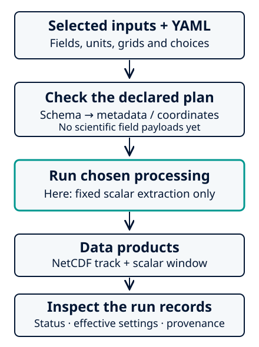
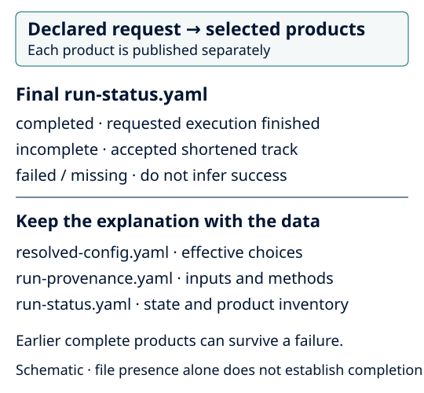
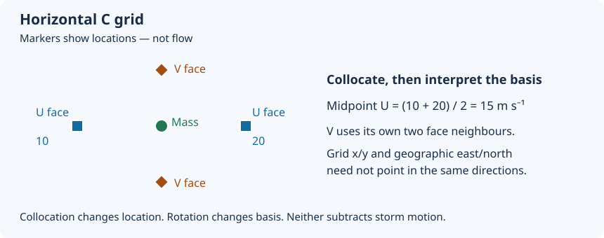
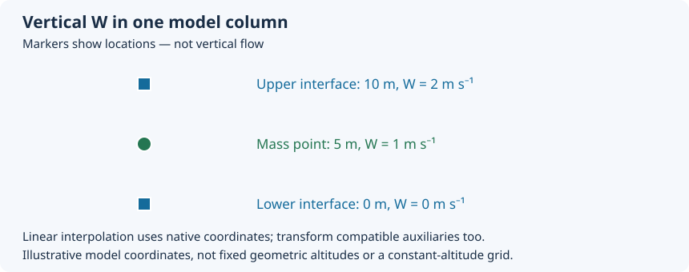

Output files
============

FrameIt writes NetCDF products that can be opened without FrameIt, for example
with xarray/netCDF4, NCO or CDO. Alternatively, ``output.format: zarr`` selects
sharded Zarr v3 directory stores, readable with compatible xarray/Zarr readers
(not the NetCDF readers NCO/CDO). Existing scripts still need compatible variable
definitions, dimensions, coordinates and reader support; a matching format alone
does not make schemas or physical quantities equivalent.

Omitted ``products`` requests model-grid fields only. Omitted ``region`` keeps
the full domain, without calculating a centre or writing a track. Independent
sources keep their own timestamps, grids, units and missing values; their
clocks need not overlap. Review ``run-status.yaml`` and provenance before using
the products. A completed run is not scientific approval.

Distinct admitted native grids keep their own coordinates in one source dataset.
Colliding axes use inventoried grid identity, not implicit alignment. Unsupported
or ambiguous combinations fail rather than dropping coordinates or interpolating.

   Schematic of a regional scalar request with track export. Full-domain
   model-grid copying does not require a centre or track.

Naming convention
-----------------

All files use ``run.name`` as a prefix (see :doc:`configuration_file`), referred to below as ``SIMU``.

Field datasets use one file per source and requested product:

- ``SIMU.<source>.model_grid.nc``
- ``SIMU.<source>.polar.nc``

Zarr field datasets use the same names with ``.zarr``. Source names are the
keys under ``sources``; they do not identify a model or physical type.
An explicitly requested trajectory uses ``SIMU.track.nc``, independently of
the field format. A centre provider alone does not request trajectory export.

Native extraction does not normalize field units, rotate winds, interpolate
or compute unrequested diagnostics. A single component can be copied without
loading an unselected companion. Vertical-coordinate unit conversion changes
labels and their metadata, not the physical array values or field units.
Unresolved scientific or representation binding fails before output; an accepted
YAML request alone does not establish that its methods are executable.

``output.directory`` is the run root (see :doc:`configuration_file`).
Artifacts use the same layout for ordinary runs and each matrix case::

    <output_dir>/
        cache/       # GRIB index files
        products/    # Requested source/product .nc files or .zarr stores
        logs/        # Simulation logs
        run-request.yaml      # Captured authored request, overrides and path bases
        resolved-config.yaml  # Effective schema-version-3 configuration
        run-provenance.yaml   # Geometry, inputs, units, and execution settings
        run-status.yaml       # Completion state, runtime/resources, product inventory
        .frameit-run.lock     # Present while an attempt owns this root

Each attempt creates a new log file. An occupied log name gets a numeric suffix;
existing files and file aliases are never opened for appending.
Product and run-record destinations cannot replace an inventoried source file.
A directory product cannot contain declared input paths, including aliases and
excluded files: replacing the store would remove those paths.

Coupled and native FA products
------------------------------

Each source has its own model-grid dataset, for example
``SIMU.ocean.model_grid.nc``. Independent extraction does not intersect clocks or
regrid sources onto a common mesh. A requested operation needing shared centres
must resolve its time association explicitly. See :doc:`fa_inputs` for coupled
and FA-specific method limits.
FA variables additionally carry a JSON ``fa_field_descriptor`` input snapshot
and ``fa_field_descriptor_scope``. This is a representative input-record
description, not a combined multi-time or post-crop description. Per-file
descriptors and post-decode scaling/mask facts are retained in run provenance
and decoder logs; see :doc:`FA metadata and provenance <fa_contracts>`.
Spectral FA coefficients have no admitted output contract and cannot be returned
as gridpoint values; see :doc:`Spectral support and limitations <fa_spectral>`.
Explicit native atmospheric cubes use separate ``level``/``level_w`` axes,
original record IDs and source-native indices, plus pressure-valued/normalized
interface coefficients and the source reference pressure. Native indices are
not pressure or height coordinates; the complete coefficient axis survives
sparse data selection without re-expanding unselected levels. See
:doc:`Native atmospheric levels and cubes <fa_atmosphere>`.

Decoder observations identify actual helper/backend versions, returned native
masks and post-normalization full-native nonfinite counts. A count before
cropping is not the output mask. Support labels, native undefined/IEEE NaN
samples, extension zones and valid physical zeroes remain separate facts.
Missing values are not converted to physical zeroes to complete an output.

``sources.<id>.fa_decoder.payload_reads`` identifies actual read calls by source
basename and native field. Decoder JSONL logs retain individual requests and
scaling observations; see :doc:`fa_contracts` for descriptor meanings and limits.

Projected FA tracking adds selected-grid latitude/longitude and source-CRS
snapping offsets to the track, source-prefixed in coupled products. Continuous
``lat``/``lon`` remain requested centres; see
:doc:`FA geometry and centres <fa_geometry>` for conventions.
With ``products.polar.shared_grid: true``, source-qualified products use common
radius/azimuth controls and verified geography at their associated centres.
Native source clocks need not match. Masks, variable meanings and vertical axes
remain independent. See :doc:`Coupled atmosphere/surface sampling <fa_surface>` for target
settings and :doc:`ocean_netcdf` for ocean-specific conventions.

Completion, provenance and ordinary readers
-------------------------------------------

GRIB indexes are stored in ``cache/``, never beside the input files. Cache
filenames distinguish input paths and cfgrib indexing keys. Meso-NH NetCDF
loading does not create disk indexes; its processing caches remain in memory.
Normal execution atomically publishes each complete NetCDF/YAML file through a
same-directory temporary file. Interrupted attempts can retain complete earlier
products or hidden ``*.partial`` files. The authoritative completion record is
``run-status.yaml`` (schema version 1). Running checkpoints record successful
publications; the final state is written after export and input cleanup.
It lists relative product paths, byte sizes, tracking completeness, execution
limits, package/native-backend versions and selected Slurm metadata. Scientific
provenance also records versions and code revision/dirty state when available.
``planned_products`` describes intent; ``products`` lists complete publications
observed by the parent. ``pending`` retains unresolved processing, publication
or cleanup phases. ``updated_at`` is the last checkpoint time, not a heartbeat.
Its ``layouts`` section records selected-reader and product chunk applications,
dimensions and uncompressed array sizes. Published field descriptors record
the actual reopened storage layout. Array estimates exclude unresolved decoder,
backend and processing workspace; they are not process-memory limits.
Sizes and paths are not content checksums. ``completed`` means the requested
execution finished; a permitted shortened track is marked ``incomplete``.
With the default ``region.tracker.on_incomplete: error``, an incomplete track fails
before export. Missing final status, a failed state or an abnormal process exit
must not be inferred successful from the presence of one file. Atomic publication
is per product, not an all-products transaction or an fsync durability guarantee.
See :doc:`/getting_started/hpc` for states, ownership and retry policy.

Read the last-recorded result without reopening the original archive:

.. code-block:: bash

   frameit status ./results

The summary distinguishes actual publications from plans and shows recorded
fields/paths, warnings, exclusions, failures and pending work. It does not verify
payload values or infer process liveness from ``running``. A successful status
command is not scientific validation.
Recorded ``completed`` or accepted ``incomplete`` returns exit code 0.
``running``, ``failed``, ``interrupted`` or unreadable required records returns 1.
Syntax errors return 2.
An accepted shortened track remains visibly incomplete.

The attempt captures ``run-request.yaml`` before processing. It keeps the
original parsed YAML or mapping, operational overrides, requested execution
options, available code identity and configuration/launch path bases. Editing
or moving the original YAML does not change this snapshot. Runtime-only callers
without an authored request are labelled accordingly. The record preserves
parsed values, not YAML comments, formatting or checksums of the source archive.

This request record is a metadata envelope, not a runnable configuration.
Authored relative paths keep their original configuration base; operational
path overrides keep their launch base. They are not relative to the output root.
``resolved-config.yaml`` contains effective controls, but its presence does not
mean processing completed. Available provenance is saved early and updated as
facts become known; unresolved facts remain explicit.

Keep all four records with the data. After a forced kill, the last checkpoint
can remain ``running`` and omit a publication whose parent callback never ran.
It is not a full archive audit. Do not delete locks, partials or backups merely
because they look old, or infer a live process from the recorded state.

``metadata.extra`` is serialized as the JSON global attribute
``frameit_user_metadata_json`` for ordinary readers of either output backend.

   Schematic. Final status describes execution; provenance describes how the
   data were produced. Neither replaces scientific inspection of the result.

For the full-domain scalar request in :doc:`configuration_file`, inspect:

.. code-block:: python

   import xarray as xr

   with xr.open_dataset("results/products/scalar.atmosphere.model_grid.nc",
                        engine="netcdf4") as ds:
       print(ds.sizes)
       print(ds.coords)
       print(ds["instructional_scalar"].attrs)
       print(ds["instructional_scalar"].dtype, ds["instructional_scalar"].encoding)

Use the actual paths and selected variables in ``run-status.yaml``; coupled runs
have separate source datasets. Check each variable's coordinates, units, basis,
missing-value metadata and storage dtype rather than assuming that similarly
named variables share definitions. xarray normally decodes CF time and missing
values; a valid zero remains data. Source valid times, forecast reference cycles
and accumulation/averaging intervals are distinct and must not be conflated.
FA temporal declarations are instantaneous only; no interval conversion is
inferred to complete a product. JSON attributes such as ``fa_field_descriptor``
can be read with ``json.loads`` from Python's standard library.

For that request with the two-time ``frameit.testing.documentation_example``
input, the full-domain values can be checked without FrameIt:

.. code-block:: python

   import numpy as np
   import xarray as xr

   with xr.open_dataset("results/products/scalar.atmosphere.model_grid.nc",
                        engine="netcdf4") as ds:
       q = ds["instructional_scalar"]
       assert q.shape == (2, 17, 17)
       assert q.dims == ("time", "y", "x")
       np.testing.assert_array_equal(ds.y, np.arange(17))
       np.testing.assert_array_equal(ds.x, np.arange(17))
       assert q.attrs["units"] == "1"
       assert q.values[0, 8, 8] == 0
       assert np.isnan(q.values[:, 7, 9]).all()
       print(ds.time.values, ds.latitude.attrs, ds.longitude.attrs)

Use :doc:`../concepts/missingness_and_status` to distinguish missing support from
zero, and :doc:`../concepts/time_support` when labels and averaging intervals differ.
For NEMO ``preceding_hour`` association, inspect native ``time``, unchanged bounds
and the separate ``center_time`` association. Native ocean depth and CROCO sigma
retain their own axes/dependencies; polar sigma samples are not constant-depth
sections. See :doc:`ocean_netcdf` before reconstructing or comparing depth fields.

.. _sharded-zarr-output:

Sharded Zarr v3
---------------

Select ``output.format: zarr`` after installing the optional ``zarr`` extra
(Python 3.13, xarray >= 2026.9.0, Zarr-Python >= 3.4.2 and < 4). NetCDF remains
the default. Requested field datasets are local directory stores:
``SIMU.<source>.model_grid.zarr`` and ``SIMU.<source>.polar.zarr``.
A separately requested track remains NetCDF. Only one field format is written.
Choose the format with ``output.format`` before execution. A Python execution
option may change the NetCDF writer engine, but cannot override the declared
field format.

Variables, dimensions, coordinates, physical units, missing samples and
scientific metadata meanings are preserved. Decoded values are written without
additional quantization or source integer repacking. Compression is lossless
gzip at ``output.writer.compression.level`` (default 1; 0 disables it); coordinates are
uncompressed unless ``output.writer.compression.coordinates: true``. There is no
NetCDF-style unlimited dimension, append/resume or remote-store support.

Chunks versus shards
~~~~~~~~~~~~~~~~~~~~

A **chunk** is a small block of array values encoded and compressed independently.
A reader can decompress only the chunks needed for a selection rather than the
whole array. Smaller chunks can reduce unnecessary reading for small selections,
but too many tiny chunks add indexing, compression and scheduling overhead.

A **shard** packs several chunks into one stored object: one file in these local
stores. This reduces the number of files without making the whole shard the
unit of decompression. Compatible readers can retrieve individual chunks inside
a shard; actual disk I/O and caching depend on the reader. Larger shards reduce
file counts but can increase write memory and the amount of work per task.

Both sizes count **array elements along each named dimension**, not bytes or
numbers of files. For example::

    output:
      format: zarr
      writer:
        chunks: {time: 1, y: 128, x: 128}
        shards: {time: 8, y: 512, x: 512}

On a sufficiently large ``y/x`` grid, each chunk holds one time and 128 by 128
grid points. Each full shard covers
eight times and 512 by 512 points: ``8 * 4 * 4 = 128`` chunks. Boundary shards
can be partially filled; arrays need not be divisible by these sizes. These
settings do **not** change scientific resolution, sampling, precision or values.

Defaults and tuning
~~~~~~~~~~~~~~~~~~~

Both mappings are optional; ``output.format: zarr`` alone works. For each product:

* Time chunks contain one element; a time shard spans eight chunks.
* The last two non-time dimensions in dataset order use chunk extents of
  ``min(dimension length, 128)``, with four chunks per shard along each axis.
  These normally correspond to the two spatial axes. Other dimensions use
  chunk and shard extents of one, avoiding large vertical-cube write blocks.
* Explicit chunk sizes replace those defaults. Without a shard override,
  the default number of chunks per shard is retained.
* A shard-only override chooses a chunk extent equal to the greatest common
  divisor of the default chunk extent and requested shard extent. Supplying
  both settings avoids surprises and gives direct control.
* All sizes must be positive integers, not YAML booleans. Explicit shard
  extents must be multiples of explicit chunk extents. Configured dimensions
  absent from one product need not apply to it, but an explicit dimension that
  matches no applicable field dataset fails. A separate track does not make a
  field-writer setting valid. Check actual exported dimensions, not input names.
* Scalars such as a CRS variable are not sharded. Empty dimensions fail with
  an actionable error; this writer does not publish empty-axis products.

Storage dimensions must match the exported dataset. The fragment above uses
the atmospheric centre-grid output axes, not native latitude/longitude axes. Inspect
the actual dimensions before setting chunks for another grid. The actual
layout is inspectable in each array's ``zarr.json`` metadata or through
``zarr.open_group(path)[variable].chunks`` and ``.shards``.

Storage chunks are not the input or polar-processing **Dask chunks**. Before
writing, FrameIt rechunks lazily to shard boundaries so parallel tasks do not
write different chunks into the same shard simultaneously. It does not load
the entire dataset eagerly. Write memory depends on shard size, dtype and
concurrency; explicitly requesting very large shards can still exhaust memory.
Zarr's internal concurrency is capped to one while writing, leaving parallelism
to the configured Dask/export workers. There is no universally optimal layout:
start with defaults and measure representative selections before tuning.

The :doc:`storage/resource guide <../task_guides/storage_and_resources>` includes
the chunks/shards schematic and a bounded pilot configuration.

Completion and reading
~~~~~~~~~~~~~~~~~~~~~~

FrameIt writes a private sibling temporary directory and publishes it after
the complete store has been written. Under the existing exclusive run-root
lock, a replacement first renames the previous store to a private backup;
caught publication errors restore that backup. Unlike NetCDF file replacement,
replacement of a nonempty directory has a brief visibility gap and is **not an
atomic directory exchange**. A killed process can leave hidden
``.frameit-*.partial`` or ``.frameit-*.backup`` directories. A backup may contain
the previous complete product; do not delete or restore it until the writer
has stopped. Unrelated directories and symlinks are not overwritten as stores.
This is not an fsync durability or all-products transaction guarantee.

``run-status.yaml`` remains the authoritative completion record. Its product
paths refer to store directories and ``size_bytes`` sums all stored files
recursively, not the directory inode size. Paths and sizes are not checksums.
Scientific provenance retains effective settings and the loaded Zarr version.

No FrameIt import is needed to read a completed product:

.. code-block:: python

   import xarray as xr

   with xr.open_zarr("results/products/scalar.atmosphere.model_grid.zarr",
                     consolidated=False) as ds:
       print(ds.sizes, ds.coords)
       print(ds["instructional_scalar"].attrs)

Stores use v3 dimension metadata and non-consolidated metadata. Readers must
support Zarr v3, its sharding codec and the stored dtypes. The writer dependency
versions above provide a tested reader combination.

Produced files
--------------

SIMU.track.nc
~~~~~~~~~~~~~

This file contains the fixed or moving geographical centres and track diagnostics:

- Coordinates: ``time``
- Data variables: center indices (for example ``cx``, ``cy``), latitude and longitude, motion estimates
  (for example ``heading_deg``, ``speed``), and any additional diagnostic variables created by
  ``enrich_track_with_kinematics``.

For a single-time automatic track, ``lat`` and ``lon`` still identify the centre
used by every coupled source. ``heading_deg``, ``dist`` and ``speed`` are NaN:
one position cannot establish motion, and missing motion is not physical zero.

SIMU.<source>.model_grid.nc
~~~~~~~~~~~~~~~~~~~~~~~~~~~

These datasets contain requested model-grid fields. Without a region, native
extraction keeps the full domain. It does not create a shared mesh across sources.

Typical structure:

- Dimensions: ``time`` and each field's spatial axes
- Each 3D field keeps its vertical axis, including a length-one selection
- Coordinates describe the actual source sampling locations and vertical labels
- Data variables depend on the YAML request (see :doc:`configuration_file`)

Read each field's own coordinates; equal names alone do not establish equivalent
sampling or physics.

.. _model-grid-coordinate-names:

Model-grid coordinate names
''''''''''''''''''''''''''''

Horizontal dimension names identify sampling locations. Their dimension-coordinate
values are local zero-based array positions, including in a crop. Original native
coordinates and source indices remain as auxiliaries; the local index is not a
distance, source-file index or wind direction. Coordinate naming alone does not
interpolate a field, rotate a vector or convert units.

**Atmospheric/SURFEX centres**
    Dimensions ``y, x``; geography ``latitude, longitude``.

**Meso-NH U**
    Dimensions ``y, x_u``; geography ``latitude_u, longitude_u``.

**Meso-NH V**
    Dimensions ``y_v, x``; geography ``latitude_v, longitude_v``.

**NEMO T**
    Dimensions ``y_t, x_t``; geography ``latitude_t, longitude_t``.

**CROCO rho**
    Dimensions ``y_rho, x_rho``; geography ``latitude_rho, longitude_rho``.

**CROCO U**
    Dimensions ``y_rho, x_u``; geography ``latitude_u, longitude_u``.

**CROCO V**
    Dimensions ``y_v, x_rho``; geography ``latitude_v, longitude_v``.

These names apply to admitted grids; they do not add support for another adapter or
grid. Each field references its own geography. Geographic positions include time
when they move. Distinct grids and vertical axes remain separate in one dataset;
they are not aligned merely because shapes or coordinate values match.

Pressure axes use ``pressure`` with their actual units. Height above ground uses
``height_above_ground``. Meso-NH/FA native labels retain ``level`` and ``level_w``;
NEMO depth axes retain their own ``deptht/depthu/depthv/depthw`` identity, and
CROCO sigma retains ``s_rho/s_w``. Labels, bounds, formula dependencies and
singleton selections remain. Hybrid/sigma/model labels do not become fixed
pressure, height or depth.
NetCDF may omit a bounds variable's redundant units attribute; those bounds use
the units of the coordinate declaring them.

When distinct axes would collide, qualification uses inventoried grid identity,
resolved before field filtering. Adding, reordering or filtering fields must not
rename an existing field's axes. Inspect original-coordinate identity/provenance
before adapting a downstream script; a matching file format alone does not make
its expected schema or physical definitions compatible.

For an unqualified horizontal axis, original labels use
``<native-dimension>_source_coordinate`` and source-file positions use
``<native-dimension>_source_native_index``. For example, ``ni_source_coordinate``
retains the native labels and units behind exported ``x``. If the source has no
explicit dimension-coordinate, only the index auxiliary is supplied; no physical
coordinate is invented.

Distinct colliding axes use deterministic inventory-derived suffixes. Their
original auxiliaries use the qualified exported axis as prefix. Bounds,
coefficients and mapping variables are also qualified when necessary, and field
references use the stored names. Read JSON ``frameit_output_coordinates_json``
for original dimension/geography identities and auxiliary names.
Formula and cell-measure term labels retain their defined meanings; only the
referenced variable names change.

Moving-grid identity follows the complete inventoried coordinate trajectory,
not just the horizontal shape. Independent trajectories can share a snapshot.
Coordinate provenance includes ``native_grid_id`` for each exported coordinate
set, including separate output views of a shared native snapshot.

.. _wind-grid-contract:

Wind locations, reference frames and output choices
~~~~~~~~~~~~~~~~~~~~~~~~~~~~~~~~~~~~~~~~~~~~~~~~~~~

.. note::

    Native model-grid copying preserves component values, units, sample locations
    and basis. Any change needs an explicit, supported transformation.
    Numerical conventions and qualification limits are in :ref:`wind-preparation-method`.

**Location is not direction.** On a Meso-NH C grid, U and V are sampled on
different horizontal faces; scalars occupy mass points. **Grid-aligned components**
(grid-relative) follow the model's x/y axes. **Eastward/northward components**
(Earth-relative) have U positive toward geographic east and V toward geographic
north.
Collocation changes sampling locations; rotation changes the vector basis.
Neither operation subtracts storm motion: exported velocities remain relative
to the ground, not the moving storm. See :ref:`wind-component-directions`.

   Original schematic. Symbols mark sample locations, not flow arrows.
   For a midpoint, U at the two faces (10 and 20 m s-1) gives mass-point
   U = 15 m s-1. V is collocated along its own staggered axis.

Use source ``transforms`` for requested model-grid changes. Sampling, basis and
unit changes are separate choices; see :doc:`configuration_file`.

* ``sampling: native`` preserves source sampling locations. Basis and units stay
  unchanged unless separately transformed. U/V keep their own coordinates;
  geographic vector analysis may need collocation and rotation.
* ``sampling: mass`` puts supported components at mass points. This requires
  interpolation and its neighbours; these are not native samples.
* ``basis: earth`` rotates supported pairs to eastward/northward components.
  It needs reliable pair and rotation metadata. Collocation is a separate operation.

Native model-grid output preserves source sample locations, staggering, units and
basis. A requested box needs distinct
``(y_u_box, x_u_box)`` and ``(y_v_box, x_v_box)`` axes for U and V. Along a
staggered direction, N mass cells have N+1 bounding faces; unavailable faces are
NaN. Source coordinates, including face geolocation, remain auxiliary coordinates
on these box axes. Full-domain native output without a crop retains original
dimensions. Read each field's coordinates rather than assuming literal source
dimension names survive a crop.

Tracking and polar processing prepare their own required analysis representations.
A model-grid transform does not request the same transform for another product
or change unrelated native fields.

Explicit results carry ``frameit_method``, ``frameit_preparation``,
``frameit_sampling``, ``frameit_basis``, ``frameit_selection_grid`` and
``frameit_shared_levels``. These describe the requested operation and selection;
``native`` means preserve that aspect, not an inferred geographic direction.
Read actual component metadata and coordinates alongside them. Per-source
provenance records method, inputs, preparation, time/cycle, units and shared levels.
For coordinate rotations, each operation also records the actual angle's name,
dimensions, values and attributes under ``rotation_coordinate``. A changing
exported angle follows ``time``; it does not define a different sampling grid.

Copying a component does not resolve contradictory basis metadata. An operation
needing a vector basis must check its declarations and input evidence, including
any admitted :ref:`Meso-NH missing-projection exception <missing-mesonh-wind-projection>`.
Record an applied exception as a user assumption, not evidence that grid and
Earth directions coincide. Native copying alone does not apply that analysis
interpretation or change source flags.

An explicitly requested derived speed uses collocated mass-point components,
:math:`\sqrt{u_m^2+v_m^2}`, even beside native Cartesian U/V. Taking ``hypot`` of
U and V face arrays combines different locations and is not a point wind speed.
Polar horizontal winds are always collocated, Earth-relative samples on
``(rr, theta)``; speed is computed from the interpolated components, not by
interpolating native scalar speed. A speed-only request loads the declared pair
internally without exporting internal-only components. For polar products,
retaining native staggering applies only to **vertical W interfaces**, never to
horizontal U/V faces or their basis.

Vertical W and level selection
''''''''''''''''''''''''''''''

   Original one-column example: lower W = 0 m s-1 at coordinate 0 m,
   upper W = 2 m s-1 at 10 m, giving mass W = 1 m s-1 at 5 m.
   These are illustrative model-coordinate values, not a constant-altitude grid.

Interpolate using actual native coordinate positions, before sparse selection
removes neighbours. Coordinates and compatible auxiliaries must describe the
new sampling locations too: changing only the W dimension label is insufficient.
Terrain-following mass/interface coordinates do not imply fixed geometric
altitudes; this operation is not interpolation onto constant-altitude surfaces.
W and its internal mass-point carrier are handled field by field. Choosing mass
W moves W to the mass-level group, removes its internal carrier from exports,
and does not move or discard other interface variables or their coordinates.

The source's single ``variables.levels`` selector applies on each requested
representation. After a grid-changing transform, select on its destination
grid; required native neighbours remain internal support, not extra exports.
Omission keeps all available levels. See :doc:`../task_guides/field_selection`
for index, value, physical-domain and unit rules.

AROME ``w`` is pressure vertical velocity :math:`\omega=Dp/Dt` in Pa s-1;
``wz`` is geometric vertical velocity in m s-1. They remain distinct quantities.
There is no implicit hydrostatic conversion or substitution between them, and
the Meso-NH W staggering choices do not turn omega into geometric velocity.
See :doc:`input_files` for authoritative model/GRIB definitions and
:doc:`configuration_file` for explicit pair and rotation declarations.

.. _simu-polar-group-nc:

<run>.<source>.polar.nc
~~~~~~~~~~~~~~~~~~~~~~~

One dataset contains the requested source's polar point samples, for example
``products/polar-scalar.atmosphere.polar.nc``. The product's radius and native
support are independent of any model-grid crop; polar-only requests need no width.
Different source grids, clocks, masks and vertical axes remain distinct.

- Dimensions include ``time``, ``radius`` and ``azimuth``, plus each field's own
  retained vertical/member dimensions.
- ``radius`` is in kilometres. ``azimuth`` is in radians clockwise from north;
  ``azimuth_degrees`` gives the degree helper. Full rings omit the duplicate endpoint.
- ``latitude(time, radius, azimuth)`` and ``longitude`` describe target positions.
  ``center_latitude``, ``center_longitude`` and ``center_time`` record their
  associated centre. ``time`` retains the native source sample clock.
- ``radial_bearing`` is the local terminal-forward geodesic bearing, not a
  requested radial/tangential diagnostic. Offset/spacing coordinates describe
  target geometry, not a new source grid or area cell.

Each requested field has ``<field>_geometry_mapped``, support fraction,
interpolation status, validity, ring coverage and full-ring eligibility arrays.
Quality arrays have ``frameit_role="interpolation_quality"``; support is a
weight fraction, not area coverage. Global ``geometry_mapped`` is the intersection
of selected field geometries, not a common source mask. Inspect the per-field
flags beside the actual values; zero is not missing.

Native component sampling does not request speed or radial/tangential winds.
Requested speed is magnitude after component sampling. Its JSON
``polar_component_options`` records actual input methods/policies; support is
the minimum component support and validity requires both sampled components.
Other sampled fields record their own interpolation, policy and threshold.
See :doc:`../polar_projection/xESMF_proj` for flags, coverage equations,
spacing rules, numerical-API naming and origin conventions.

.. _polar-numeric-types:

Polar numeric types
''''''''''''''''''''

A proven continuous field with integer prepared values is evaluated as float64
for bilinear sampling. This preserves fractional results; it does not change
native/model-grid exports. Floating inputs keep their prepared evaluation dtype.
Nearest sampling retains label values rather than averaging them, although its
stored output can use a floating dtype to represent missing data.

The JSON field attribute ``polar_numeric_types`` and each input's provenance
record give the prepared dtype, evaluation dtype and conversion. Prepared means
after decoding and selected preparation, not necessarily the encoded storage
type. A floating output dtype alone does not prove correct evaluation.
Ordinary floating-point roundoff still applies. Float64 cannot exactly represent
every integer beyond :math:`2^{53}`; no bitwise or large-integer exactness is
promised.

Metadata and attributes
-----------------------

FrameIt adds a minimal set of global attributes to each file:

- ``Conventions`` (currently ``CF-1.8``)
- ``title``, ``summary``, ``institution``, ``source``
- ``simulation_id`` (from ``run.name``)
- ``frameit_version`` (from the installed FrameIt package)

Additional export-specific attributes:

- ``product_type``: ``model_grid``, ``polar`` or ``track``
- ``source_id``: the source name for native field datasets
- ``track_filename``: an associated published track, when one exists

Optional ``metadata.extra`` annotations are stored separately under
``frameit_user_metadata_json``. They cannot replace generated scientific
provenance. A conflicting generated JSON attribute name fails rather than
silently hiding either value.

A ``history`` attribute is appended at write time and includes a UTC timestamp and the exporting module.

Attribute sanitization
~~~~~~~~~~~~~~~~~~~~~~

NetCDF backends do not accept complex Python objects as attributes. During export:

- Python dictionaries, lists, or tuples found in ``ds.attrs`` are converted to JSON strings and stored under
  a ``*_json`` attribute name.
- Boolean attributes are converted to integer flags (0 or 1), because the netCDF4 backend does not support
  boolean attributes.

Compression and performance
---------------------------

By default, the exporter applies DEFLATE compression to all data variables:

- ``zlib=True``, ``shuffle=True``, ``complevel=<compress_level>``

Notes:

- Lower compression levels (for example 1) typically write faster but generate larger files.
- Higher compression levels reduce size but increase CPU cost during export.
- Export time is also controlled by dask materialization, because writing triggers computation of lazy arrays.

Coordinates are not compressed by default. Configure storage with
``output.writer.compression: {level: 2, coordinates: false}``. The default level is 1;
NetCDF storage chunks are backend-selected unless ``output.writer.chunks``
sets element counts on exported dimensions. Zarr chunk/shard rules are described
above.
Compression is lossless. The NetCDF writer adds no quantization or requested
reduced-precision encoding; inspect each variable's actual dtype/encoding with
the reader rather than assuming every prepared quantity has the source dtype.
Source packing and storage-layout encodings are not reapplied to decoded values
or coordinates. Required time/calendar and missing-value declarations retain
their meaning.
A non-``None`` ``_FillValue`` on a decoded floating array is written as NaN.
The source's packed fill code must not mask a valid decoded zero. Explicit
no-fill declarations and integer/time handling are unchanged.

Export selection
-----------------

Omit ``products`` for model-grid output only. List ``model_grid``, ``polar`` or
``track`` to request them explicitly; there is no separate export switch.
Each field product can narrow the declared fields by source. Omit products you
do not need. An explicit empty mapping is invalid. See :doc:`configuration_file`
for product and method settings.
